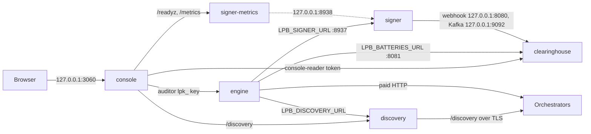

# builder-core-console: research notes

Source: `github.com/NE-Build-Track/builder-core-console` at commit `274a361`, cloned read-only at
`.reference/builder-core-console`. Everything below was read from the repository (docs, compose files,
scripts and the whole `web/` source). Nothing was run and no live service was called. File paths are
relative to that repository's root unless they start with `docs/research/`.

Contents:

1. [Stack and structure](#1-stack-and-structure)
2. [Every view and route](#2-every-view-and-route)
3. [Upstream API calls, by service](#3-upstream-api-calls-by-service)
4. [Tokens and auth](#4-tokens-and-auth)
5. [The "Sources & gaps" approach](#5-the-sources--gaps-approach)
6. [The Docker stack](#6-the-docker-stack)
7. [Data model and vocabulary](#7-data-model-and-vocabulary)
8. [Conflicts with our operator-console outline](#8-conflicts-with-our-operator-console-outline)
9. [Checklist: what the console shows → where ours must show it](#9-checklist-what-the-console-shows--where-ours-must-show-it)
10. [Unclear, stale or surprising](#10-unclear-stale-or-surprising)

---

## 1. Stack and structure

### What it is

The "Builder console" is the Build Track's M3 reference app for one livepeer-builder stack: the stock
builder-core engine (`lpb serve`), Clearinghouse Batteries and the livepeer/node remote signer, run as
Docker services (`README.md`, `AGENTS.md`). It has three parts:

- **Seven read-only pages** (Health, Network, Money, Users, Usage, Jobs, Sources & gaps). No sign-in,
  bound to `127.0.0.1`, GET requests only (decisions D1, D7 in `docs/design-docs/decisions.md`).
- **Operator actions** (`/operator`): sign in with an engine **admin** key; create and fund grants,
  provision and fund actors, set allocation status, rotate the payment key, revoke; issue, rotate and
  revoke access keys (D15–D18).
- **Builder** (`/builder`): sign in with an engine **actor** key; catalog with wholesale rates, one
  generic job form with streamed output, my jobs, my allowance and cost (D19, D20).

### Versions (`web/package.json`, `docs/FRONTEND.md`)

| Thing | Version |
| --- | --- |
| Next.js (App Router, Cache Components, `output: "standalone"`) | 16.4.2 |
| React / react-dom | 19.3.1 |
| TypeScript (strict, `noUncheckedIndexedAccess`) | 5.9.3 |
| Tailwind CSS v4 (`@tailwindcss/postcss`) | 4.3.3 |
| shadcn (configured, style `radix-nova`; `components/ui/` is empty) | 4.22.1 |
| `openapi-fetch` (engine client, adapters only) | 0.17.0 |
| `openapi-typescript` (generates `src/domain/engine-schema.d.ts`) | 7.13.0 |
| `openid-client` (OIDC, `adapters/oidc/` only) | 6.8.8 |
| `zod` (Batteries, signer, discovery shapes; `domain/` only) | 4.6.7 |
| `server-only` | 0.0.1 |
| Vitest | 5.0.5 |
| Node | >= 24 (image `node:24-bookworm-slim`) |
| pnpm | 10.33.2 (`packageManager`) |
| Fonts | `@fontsource-variable/bricolage-grotesque`, `geist`, `geist-mono` 5.3.0 |

`web/next.config.ts`: `cacheComponents: true`, `partialPrefetching: true`, `output: "standalone"`,
`poweredByHeader: false`, `allowedDevOrigins: ["127.0.0.1"]`, `agentRules: false`. Middleware is
`web/src/proxy.ts` (Next 16 calls it `proxy`).

Pinned upstreams (`web/src/domain/pins.ts`, `deploy/compose.yaml`, `docs/references/payment-stack.md`;
`web/tests/structure/pins.test.ts` fails if they disagree):

| Component | Repository | Commit |
| --- | --- | --- |
| Engine | `NE-Build-Track/livepeer-builder-core` | `15142129ebbf51103658f8ad48fd5adae052c56d` (`releases/m3`, D58–D62) |
| Batteries | `livepeer/clearinghouse-batteries` | `ca09e47c067682fb48c3f15425546fb6aa5b6659` |
| Signer | `livepeer/node` | `406b248f6cb8728e6e7eba1809901f589060bc6b` (v1.0.2) |

### Folder layout

```text
AGENTS.md, ARCHITECTURE.md, README.md, CLAUDE.md, Makefile
openapi/engine.openapi.json     the pinned engine's OpenAPI spec (source of engine types)
deploy/                         compose.yaml, .env.example, first-run.sh, init-secrets.py,
                                config/{clearinghouse.toml,signer.toml,orchestrators.txt},
                                console/Dockerfile, keycloak/{compose.yaml,realm-livepeer.json,first-run.sh,README.md}
scripts/                        build-images.sh, demo-traffic.py, journey-m3.py, live-check-d57.py, live-check-d57-ui.py
docs/                           product-specs/, references/ (data-sources.md, gaps.md, payment-stack.md,
                                m3-environment.md, m3-rest-operations.md, evidence/), design-docs/, exec-plans/,
                                guides/, DESIGN.md, FRONTEND.md, RELIABILITY.md, SECURITY.md, QUALITY_SCORE.md, PLANS.md
web/src/
  utils/        decimal.ts (exact decimals as bigint units of 1e-18), time.ts (windows), concurrency.ts (mapLimited)
  domain/       types layer: batteries.ts, discovery.ts (zod), engine.ts + engine-schema.d.ts (generated),
                signer.ts, reading.ts (Reading<T>, Problem), views.ts (view models), catalog.ts (route catalog),
                gaps.ts (gap registry), pins.ts, session.ts, operator.ts, builder.ts, exchange.ts, failures.ts,
                forms.ts, output.ts
  ports/        sources.ts (EngineReader, BatteriesReader, SignerReader, DiscoveryReader, Sources),
                keyed.ts (KeyedEngine, EngineWriter), identity.ts (IdentityProvider, TokenSource)
  config/       config.ts (CONSOLE_* settings; server-only)
  adapters/     http.ts (getText, GET only), seal.ts (AES-256-GCM cookie sealing),
                engine/{reader.ts,keyed.ts,writer.ts}, batteries/reader.ts, signer/reader.ts,
                discovery/reader.ts, oidc/provider.ts  (all server-only)
  services/     pure page logic over the ports: stack-health.ts, network.ts, money.ts, users.ts, usage.ts,
                jobs.ts, nav.ts, reconciliation.ts, signin.ts, operator.ts, operator-actors.ts, builder.ts
  runtime/      console.ts (wiring, load*()), ttl-cache.ts, error-history.ts, session.ts, operator.ts,
                builder.ts  (server-only; the only thing pages call)
  components/console/   the design system: primitives.tsx, values.tsx, pages.ts, rail-nav.tsx,
                command-palette.tsx, topology.tsx, ticker.tsx, usage-chart.tsx, signer-metric-tiles.tsx,
                ambient.tsx, theme*.ts(x), toaster.tsx, tooltips.tsx, icons.tsx,
                act/{action-dialog,exchange-panel,fields,sign-in,provider-sign-in,session-bar,shown-once}.tsx,
                run/{job-runner,job-record,output-view}.tsx
  app/          layout.tsx, page.tsx (Health), network/, money/, users/, usage/, jobs/ (page.tsx, job-list.tsx),
                sources/, operator/ (page.tsx, sections.tsx), builder/ (page.tsx, gate.tsx, jobs/, usage/,
                run/route.ts, api/jobs/[id]/route.ts), auth/{login,callback}/route.ts, livez/route.ts,
                actions.ts (all server actions), session-cookies.ts, globals.css
  proxy.ts      runs before /operator and /builder pages: key probe, OIDC token refresh
web/tests/structure/   layers.test.ts, writes.test.ts, taste.test.ts, pins.test.ts, docs.test.ts
web/tests/support/     fixtures.ts (live-shaped fixtures), server-only.ts, source-files.ts
```

### Layering (`ARCHITECTURE.md`; enforced by `web/tests/structure/layers.test.ts`)

Code depends only "forward": `utils` → `domain` → `ports` → `config` → `adapters` → `services` → `runtime`
→ `components` → `app`.

| Layer | Folder | May import |
| --- | --- | --- |
| Utils | `utils/` | nothing internal |
| Types | `domain/` | utils |
| Providers | `ports/` | domain |
| Config | `config/` | domain (server-only) |
| Adapters | `adapters/` | domain, ports, config, utils (server-only) |
| Service | `services/` | domain, ports, utils (never HTTP; tested on fixtures) |
| App wiring | `runtime/` | everything above (server-only) |
| UI | `components/console/` | domain, utils |
| Routes | `app/` | runtime, UI, domain, services, utils |

Third-party confinement: `openapi-fetch` only in `adapters/`; `zod` only in `domain/`; `next`/`react`
only in `app/` and `components/`; no Gyral anywhere (D4).

### Routing

File-based App Router; one server component per page. Navigation list in
`web/src/components/console/pages.ts` (rail order):

| Key | Href | Label | Count shown in the rail (`web/src/services/nav.ts`) |
| --- | --- | --- | --- |
| health | `/` | Health | none; a flag when the verdict is not `ok` |
| network | `/network` | Network | orchestrators in `GET /discovery` |
| money | `/money` | Money | Batteries grants |
| users | `/users` | Users | rows of `GET /v1/admin/actors` (fallback: actors holding keys) |
| usage | `/usage` | Usage | applied signed tickets in the last 24 h |
| jobs | `/jobs` | Jobs | number of cost projections (max 25) |
| operator | `/operator` | Operator | none |
| builder | `/builder` | Builder | none |
| sources | `/sources` | Sources & gaps | number of open gaps |

Other routes: `/builder/jobs`, `/builder/usage`, `POST /builder/run`, `GET /builder/api/jobs/[id]`,
`GET /auth/login`, `GET /auth/callback`, `GET /livez`. Query parameters carry all page state
(`?window=`, `?id=`, `?before=`, `?app=`, `?signin=`); there is no client-side store.

### Data fetching

- Every page: a static `PageHead` (eyebrow, title, lede), then a `<Suspense>` child (`Streamed`) that
  calls `await connection()` and one `load*()` from `web/src/runtime/console.ts`. Nothing is prerendered.
- `runtime/console.ts` builds the `Sources` once per server process (settings → adapters → cached
  readers) and exposes `loadStackHealth`, `loadNetwork`, `loadMoney`, `loadUsers`, `loadUsage(window)`,
  `loadJobs(lookupId, before)`, `loadNavCounts`, `consoleSettings`, `sharedSources`, `forgetReads`.
- Every adapter method returns a `Reading<T>` (value, or source + `Problem`); nothing throws past an
  adapter, so one down source never blanks a page (`web/src/domain/reading.ts`).
- `web/src/runtime/ttl-cache.ts`: each upstream read is reused for `CONSOLE_CACHE_TTL_S` (15 s default),
  keyed by `"<source>.<method>(<JSON args>)"`, in-flight promises shared, max 500 entries, nothing
  persisted. Writes call `forgetReads()` (clears the whole cache).
- Open pages call `router.refresh()` every `max(15, cacheTtl)` seconds while the tab is visible and no
  `<dialog>` is open (`AutoRefresh` in `web/src/components/console/ambient.tsx`).
- Batteries lists are cursor-paged (limit 1000) and walked up to `CONSOLE_MAX_LIST_ROWS` (20 000);
  a capped list is marked `truncated` and pages say totals are partial (gap G6).
- Per-request upstream timeout `CONSOLE_TIMEOUT_S` (8 s). Fan-out reads are bounded (`mapLimited(…, 4, …)`).
- Signed-in areas (Operator, Builder) read through `KeyedEngine` built per request from the session's
  token; these reads are **never cached**.

### Server/client boundary

- `config/`, `adapters/`, `runtime/` and `app/session-cookies.ts` start with `import "server-only"`.
- Client components (`"use client"`) are islands that take props: `rail-nav`, `command-palette`,
  `theme-toggle`, `count-up`, `usage-chart`, `signer-metric-tiles`, `toaster`, `copy-button`, `tooltips`,
  `relative-time`, `ambient`, `act/action-dialog`, `act/sign-in`, `act/shown-once`, `run/job-runner`,
  `run/output-view`. They never import `runtime/`, `adapters/`, `config/` or `services/`
  (`layers.test.ts`).
- Server actions live only in `web/src/app/actions.ts`; POST route handlers only under
  `web/src/app/builder/`; write methods only in `adapters/engine/writer.ts` and `adapters/engine/keyed.ts`;
  read-only pages may not import a write path (`web/tests/structure/writes.test.ts`).
- The browser never talks to the engine, Batteries or the signer (D4).

### Shell around every page (`web/src/app/layout.tsx`)

- Top bar: brand "Builder console" (links to `/`); env chip `"{applicationId} · {allocation_mode}"`
  (`CONSOLE_APPLICATION_ID` and `EngineHealth.allocation_mode` with `_` → `-`, or "engine unreachable");
  verdict pill (`verdict.short`, e.g. "Operational", "Operational, 1 warning", "Impaired, 2 failing",
  "3 checks unknown") linking to `/`; "checked {ago}"; command palette button "Search or jump to…"
  (⌘K / Ctrl K / `/`); theme toggle.
- Rail: the nine pages with counts; foot: pill "Pages read only; Operator and Builder write, after
  review"; "Engine {pinned short commit} · reports {engine version}"; "Batteries {pin} · signer {pin}";
  "Reads the stack every 15 s. Stores nothing."
- Command palette (`command-palette.tsx`): go to a page; "Usage over the last 24 hours / 7 days / 30 days";
  "Toggle light and dark theme"; every gap ("G6: Usage feed has no time filter" → `/sources#g6`); pasting
  a UUID offers "Look up job {id}" → `/jobs?id=`.
- Upstream calls made by the shell on every page: `loadStackHealth()` and `loadNavCounts()` (see Health
  below, plus Batteries `GET /v1/grants`, engine `GET /v1/admin/keys`, `GET /v1/admin/actors`,
  `GET /v1/costs/projections`), all cached.

### Shared rendering conventions

- `Unreadable` (`primitives.tsx`): a failed reading renders "{what} could not be read from {Source}" plus
  `describeProblem()`: `not configured: NAME`, `unreachable: …`, `HTTP 403: …`, `unexpected response: …`;
  a `not_permitted` problem renders as a quiet empty state "…: not available to the console's credential: …".
- `ReadFrom`: "From {Engine|Batteries|Signer|Discovery|Identity provider}, read {ago}" under each section.
- `Empty`: one-sentence empty state per section. `Truncated`: the G6 row-cap note.
- `GapChip`: a chip with the gap id next to the data it limits, linking to `/sources#g…`.
- Status is a word and a glyph: states `ok | warn | bad | unknown` → "OK", "Warning", "Failing", "Unknown"
  (`STATE_WORDS` in `values.tsx`); a healthy component says "Healthy".
- Amounts: exact decimal strings in `<data value>`, bright head / dim tail (`Amount`), rounded `Usd` for
  tiles; instants as relative time with the absolute in `<time dateTime>`; ids in `<code>`.

---

## 2. Every view and route

"Reader" below means the console's own engine credential: the `lpk_` **auditor** key in
`CONSOLE_ENGINE_READER_TOKEN` (keys mode) or the console's client-credentials token (OIDC mode).
"Batteries reader" means `CONSOLE_BATTERIES_TOKEN` sent as header `Livepeer-Clearinghouse-Token`.

### 2.1 Health — `/` (`web/src/app/page.tsx`, `web/src/services/stack-health.ts`)

Purpose: one verdict for the whole stack, then each component's checks. Eyebrow "Stack health", title
"Health".

Upstream calls (all GET, in parallel, then reconciliation):

| Service | Path | Token |
| --- | --- | --- |
| Engine | `/readyz` | none needed (reader header is sent anyway) |
| Batteries | `/readyz` | none |
| Signer (metrics relay) | `/readyz`, `/metrics` | none |
| Discovery | `/discovery` | none |
| Batteries | `/v1/usage` (whole feed), `/v1/sessions` (whole list) | Batteries reader |
| Engine | `/v1/admin/reconciliation?application_id=` (per_application mode) **or** `/v1/admin/actors?limit=1000` then `/v1/admin/reconciliation?application_id=&actor_id=` per provisioned actor in `CONSOLE_APPLICATION_ID`, four at a time (per_actor mode, gap G10) | reader |

Panels:

1. **Overall verdict** card: eyebrow "Overall verdict"; headline `verdict.headline` ("Operational" for
   ok and warn, "Partly unknown", "Impaired"); `verdict.why` (the two worst checks, or "Every check
   passes: the engine is ready, Batteries is accounting, and the signer can pay."); stats
   "{passing} of {total} checks pass", "{n} warning(s)", "{n} failing", "checked {ago}"; buttons "Usage"
   (`/usage`) and "Look up a job" (`/jobs`).
2. **Topology diagram** (`topology.tsx`, SVG, no script): nodes Engine (`"{running_jobs} jobs running"`),
   Signer (`"outbox {pending} · ready|not ready"`), Batteries (`"ledger · balanced|syncing|unattributed"`),
   up to five orchestrators (hostname; stale ones get no packets). Edges labelled "sign payment",
   "Kafka outbox", "reconcile", "job + signed ticket". Packets move only on edges whose ends are healthy.
3. **One card per component** (title, role, state pill, list of checks: glyph, label, state word, summary):

   | Component (role) | Check id · label | Field(s) | Rule |
   | --- | --- | --- | --- |
   | Engine ("Runs paid jobs and classifies their cost") | `engine.ready` · Ready | `EngineHealth.ready` | ok "Accepting jobs"; bad "Not ready: /readyz answered 503" |
   | | `engine.discovery` · Discovery | `discovery_fresh`, `discovery_observed_at`, `discovery_error` | ok "Fresh, observed {ago}"; warn "Stale: {error} (last observed …)" |
   | | `engine.cost_sync` · Cost sync | `cost_sync_at`, `cost_sync_error` | warn on error or older than 150 s; unknown "Has not synced with Batteries yet"; ok "Synced {age} ago" |
   | | `engine.version` · Version | `version` | ok when it contains the pinned short commit; else warn "Engine reports X; the console is built for Y" |
   | | `engine.load` · Running jobs | `running_jobs`, `allocation_mode` | informational: "{n} running · per-actor allocations" |
   | Batteries ("Grants, allocations and the ticket ledger") | `batteries.ready` · Ready | `/readyz` 200 | ok "Management API and accounting are up" |
   | | `batteries.balanced` · Engine agrees with Batteries | `Reconciliation.balanced`, `unattributed`, `by_class`, `provider_spent` | see reconciliation verdicts in section 7; cites G10 in per_actor mode |
   | Signer ("Signs payments and reports every ticket") | `signer.ready` · Ready to pay | signer `/readyz` 200/503 + body | ok "Chain access, deposit and reserve, price rate and outbox are healthy"; bad "Cannot pay: {body}" |
   | | `signer.outbox` · Accounting outbox | `livepeer_signer_kafka_outbox_healthy`, `_pending_events`, `_oldest_event_age_seconds` | bad when unhealthy or oldest > 300 s; warn when pending > 0; ok "Every signed ticket has reached Batteries" |
   | | `signer.errors` · Delivery errors | sum of `_publish_errors_total`, `_enqueue_errors_total`, `_storage_errors_total` | warns for one hour after the total last rose, using in-memory samples (`runtime/error-history.ts`, D22) |

   A source that cannot be read gives one `bad` check with the problem. Component state = worst check
   (rank ok < unknown < warn < bad); overall = worst component.
4. **Signer metrics** (`signer-metric-tiles.tsx`; cites G5): tiles `livepeer_signer_kafka_pending_events`
   ("events waiting in the outbox", sparkline), `oldest_event_age_seconds` (sparkline),
   `publish_errors_total` (pill "none since start" / "none new in the last hour" / "since the signer
   started"), `outbox_healthy` ("Healthy"/"Unhealthy"/"not reported"). Sparklines are samples since the
   page opened (max 40).
5. **Latest signed tickets** ticker (`ticker.tsx`): the 18 newest `applied` usage events: fee
   (`computed_fee_usd` + " USD"), app and orchestrator (from the payment session), relative time. Empty:
   "No signed tickets yet. They appear once a paid job runs."

No filters or actions.

### 2.2 Network — `/network` (`web/src/app/network/page.tsx`, `web/src/services/network.ts`)

Purpose: "What the engine can buy right now".

Upstream: engine `GET /v1/offerings` (reader); engine `GET /v1/runners?app=` once per distinct app, four
at a time (reader); discovery `GET /discovery`; engine `GET /readyz`.

Panels:

1. **Tiles**: "Apps on offer" (`totals.apps`); "Orchestrators" with sub "{fresh} fresh, {stale} stale" or
   "none discovered"; "Runners"; "Free slots" `{free} / {slots}` with a meter.
2. Note when `discovery_fresh` is false: "Engine discovery is stale (last observed …): {discovery_error}".
3. **Offerings** ("GET /v1/offerings, joined with each app's runners"): cards for the 9 apps with the
   most capacity. Each card: app id (`Offering.app`), pill "Available"/"Saturated" (free slots > 0),
   `"{modes} · {ready_count} of {runner_count} runners ready"`, key-values "Runners", "Orchs", "Free
   {free}/{total}", a meter, price range `"{low} – {high} {currency}/{unit}"` or "no price reported"
   (from each runner's `rate.amount/currency/unit`). Below, a collapsed table "All N apps": columns
   **App, Runners, Orchs, Free / total slots, Price**. Offerings are merged per app (the engine lists an
   app once per currency and unit, D62). Empty: "The engine offers no apps yet. Discovery may still be
   warming up."
4. **Orchestrators** ("GET /discovery on the discovery service: what the engine reads"): one card each:
   ring gauge of `capacity_available` / `capacity` summed over runners, hostname and full `address`, pill
   "Seen {ago}" / "Last seen {ago}" (stale if `last_seen` is null or older than 60 s), "{n} runners", up
   to six app chips ("+N more"). Empty: "The discovery service serves no orchestrators. Check its /readyz."
5. **Runners** table (collapsed past 25 rows; caption "Every runner the engine sees, by orchestrator"):
   columns **Orchestrator** (`orchestrator_url` host), **App**, **GPU** (`gpu.name`), **VRAM**
   (`gpu.vram_mb` → GB), **Free / total slots** (`capacity_available`/`capacity`), **Price**
   (`rate.amount rate.currency/rate.unit`), **Version** (`version`). Empty: "No runners right now."

No filters, sorting controls or actions.

### 2.3 Money — `/money` (`web/src/app/money/page.tsx`, `web/src/services/money.ts`)

Purpose: "Grants fund allocations; each allocation carries gateway keys and spends through signed
tickets. Amounts come from the Batteries ledger, to 18 decimals."

Upstream (Batteries reader): `GET /v1/grants`, `/v1/allocations`, `/v1/api-keys`, `/v1/ledger/report`,
`/v1/escrow/report`, `/v1/usage`. The engine's `GET /v1/admin/grants` is **not called**: the reader
returns a `not_permitted` problem locally (`adapters/engine/reader.ts`), shown as "The engine's grants:
not available to the console's credential: the read-only auditor never reads the operator's grants".

Panels:

1. `Truncated` note when a list hit the row cap.
2. **Tiles** (USD totals across grants, `totalsByCurrency`): "Granted" (sum of `total_usd`; sub
   "{n} grants"); "Allocated" (sum of `allocated_usd`; sub "{granted − allocated} not yet allocated" and a
   meter); "Spent" (sum of `spent_usd`, 4 places, exact amount below); "Available to spend" (sum of
   `available_usd`; sub "{x}% of allocations used").
3. **Grants, allocations and keys** ("Outer ring: share of the grant spent. Inner ring: share
   allocated."). A pill compares counts when the engine's grants are readable ("Engine sees the same N
   grants" / "Engine sees X of Y grants"); with the auditor reader it never renders. One `GrantCard` per
   Batteries grant:
   - ring (spent/total outer, allocated/total inner), "Grant · {status}", `name`, `id`;
   - figures **Total** (`total_{currency}`), **Allocated** (sum of its allocations), **Spent**,
     **Unallocated** (ledger row with `account_id == grant.id` and `account_type == "grant_unallocated"`,
     `balance_{currency}`; "—" without a ledger);
   - allocation list, per allocation: `name`, short `id`, `status`, "created {ago}"
     (`created_at_ms`), runway pill "~N days left at 7-day pace" (available ÷ last 7 days' applied
     `computed_fee_usd` × 7; warn below 7 days) or "No spend this week"; **Allocated**
     (`allocated_usd`), **Spent** (`spent_usd`), **Available** (`available_usd`), a meter; **Gateway
     keys**: per key a copy button with `prefix`, pill "revoked" when `revoked_at_ms`, "used {ago}"
     (`last_used_at_ms`), or "none".
   - "Allocations with no listed grant" card for orphans.
   - Empty: "Batteries has no grants yet. Create one from Operator actions, or with the Batteries CLI
     (deploy/README.md)."
4. **Payer escrow** (`GET /v1/escrow/report`): per row a ring (reserve and deposit share of total),
   "{total} ETH total", **Deposit** (`deposit_balance_eth`), **Reserve** (`reserve_balance_eth`), facts
   **Chain** (`chain_id`), **TicketBroker** (`contract_address`), **Payer** (`sender`), **Confirmed
   through** "block {confirmed_through_block}". Empty: a note that it needs `BATTERIES_ONCHAIN_LISTENER=true`
   and `PAYER_ADDRESS` in `deploy/.env`.
5. **Ledger** (`GET /v1/ledger/report`; pill "Balances to zero" / "Out of balance" from the sum of
   `balance_usd`): table **Account** (`account_id`), **Type** (`account_type`: `allocation_available`,
   `allocation_spent`, `grant_funding_source`, `grant_unallocated`), **Balance** (`balance_usd` or
   `balance_eth`), footer "Sum of all accounts". Empty: "The ledger has no accounts yet."

No filters or actions (the gateway key prefix is copyable).

### 2.4 Users — `/users` (`web/src/app/users/page.tsx`, `web/src/services/users.ts`)

Purpose: eyebrow "Engine actors", title "Users": "Every actor the engine knows (provisioned, signed in,
or holding a key), the allocation behind it, and whether the engine's cost for that actor matches
Batteries." Cites G9.

Upstream (engine, reader): `GET /v1/admin/keys`; `GET /v1/admin/actors?limit=1000`;
`GET /v1/admin/reconciliation?application_id={CONSOLE_APPLICATION_ID}`; then per actor, four at a time:
`GET /v1/allowance?actor_id=` and `GET /v1/costs/summary?start=&end=&actor_id=` (30-day window; only for
actors in `CONSOLE_APPLICATION_ID`, gap G9) and `GET /v1/admin/reconciliation?application_id=&actor_id=`.

Panels:

1. **Tiles**: "Actors" (sub "in N applications"); "Active keys" (or "—" with sub "engine keys are off"
   when `GET /v1/admin/keys` is 404 under `LPB_AUTH=jwt`); "Balanced" (pill "engine = Batteries");
   "Needs a look" (pill "unattributed spend" or "none").
2. **Actors** table ("From GET /v1/admin/actors and GET /v1/admin/keys. Allocation, balance and 30-day
   spend read for application "{id}"."):

   | Column | Field |
   | --- | --- |
   | Actor | `KnownActor.label` (if any) above `actor_id` |
   | Application | `application_id` |
   | Keys (keys mode only) | active access keys, "+N revoked" (`AccessKey.revoked_at`) |
   | Allocation | `Allowance.allocation_id` (short) + `status`; "no allocation" on 404; "not readable (G9)" outside the console's application |
   | Available | `Allowance.available.amount` + currency |
   | 30-day spend | sum of `CostSummary.by_class[*].fee_usd` for that actor, with a relative bar |
   | Reconciled | pill: "No allocation" (404), "No spend yet", "Balanced", "Syncing" + gap, "Unattributed spend" + amount, "Engine ahead of Batteries" + gap |

   Rows sorted by application then actor. A note per actor with unattributed spend: "Batteries applied
   tickets the engine cannot tie to a job. Usually a gateway key used outside the engine." Empty: "No
   actors yet. Provision one, or issue an actor key, in Operator actions." (OIDC: "A builder appears
   here after their first sign-in.")
3. **Application "{id}"** ("GET /v1/admin/reconciliation for the whole application"): the same pill, or
   in per_actor mode (404) a G10 note.
4. **Admin and auditor keys** ("Keys that belong to no actor. An auditor key only reads; the console
   reads with one."): per key `key_id`, chip `kind`, chip "application {application_id}", pill
   "Active"/"Revoked", `label`, "created {ago}". Empty: "No admin or auditor keys listed."

No filters, pagination or actions. There is no per-user detail page.

### 2.5 Usage — `/usage?window=24h|7d|30d` (`web/src/app/usage/page.tsx`, `web/src/services/usage.ts`)

Purpose: "What the stack paid orchestrators, ticket by ticket, from the Batteries usage feed." Cites G6.

Upstream: Batteries `GET /v1/usage` (whole feed, filtered to the window in memory), `/v1/sessions`,
`/v1/allocations` (Batteries reader); engine `GET /v1/costs/summary?start=&end=` (reader).

Filter: a window switch (links, default `7d`). "24h" is rolling; "7d"/"30d" are whole UTC days ending
today (`web/src/utils/time.ts`). Buckets: 24 hourly or N daily.

Panels:

1. Window switch + ticker of the 10 newest applied tickets in the window.
2. `Unreadable` for the events; `Truncated` when the usage or session list was capped.
3. **Tiles**: "Paid to the network" (sum of `computed_fee_usd` over `applied` events); "Signed tickets
   applied" (count; sub "avg {fee} each"); "Quarantined events" (status neither `applied` nor
   `duplicate`; pill "not applied to the ledger"/"none"; "{n} duplicates ignored"); "Jobs with a cost"
   (`CostSummary.jobs_with_cost`; sub "{jobs_pending} still pending").
4. **Paid per hour|day** area chart (`usage-chart.tsx`; pointer and arrow keys) with "Show the numbers"
   table: **Hour (UTC)/Day (UTC)**, **Paid**, **Tickets**.
5. **How the engine classifies that cost** (cites G9): a stacked bar and legend for the four cost
   classes from `CostSummary.by_class`: label, `fee_usd`, share, `row_count` "rows", and a note per
   class (see section 7).
6. **By app**, **By orchestrator**, **By allocation**: ranked bars (`fee`, "{n} tickets", share). App
   and orchestrator come from the event's payment session (`PaymentSession.app`, `.orchestrator`; the
   orchestrator here is the ticket recipient address); allocation label is the Batteries allocation
   `name`. Missing session → "unknown session". Empty: "No usage in this window."
7. **Newest signed tickets** table: **Manifest** (`manifest_id`), **Applied** (`created_at_ms`),
   **App**, **Orchestrator**, **Allocation** (`allocation_id`), **Fee (USD)** (`computed_fee_usd`).
8. **Quarantined events** table ("Batteries kept these out of the ledger"): **Event** (`event_id`),
   **Received**, **Allocation**, **Reason** (`error` or `status`).

No actions.

### 2.6 Jobs — `/jobs?id=<uuid>&before=<ISO time with offset>` (`web/src/app/jobs/page.tsx`, `job-list.tsx`, `web/src/services/jobs.ts`)

Purpose: "Every job in the application, newest first, and any job by id with its attempts, the
orchestrators it tried, what each attempt cost, and the signed sessions behind it."

Upstream (engine, reader): `GET /v1/jobs?limit=50[&before=]`; `GET /v1/costs/projections?limit=25`; when
`id` is a UUID: `GET /v1/jobs/{job_id}` and `GET /v1/jobs/{job_id}/cost`, then Batteries
`GET /v1/usage?manifest_id=` once per manifest of the job's signed sessions (Batteries reader).

Panels:

1. **Lookup form** (a GET `<form>` inside `<search>`): "Job id" input (UUID pattern), "Look up". A
   non-UUID id shows "That is not a job id. Job ids are UUIDs, as in the engine's Livepeer-Job-Id header."
2. **Lookup result** (article): heading = job id, state pill (`queued`/`running` unknown, `succeeded`
   ok, `failed` bad, `uncertain` warn). Facts:
   **App** (`app` · `capability` · `model`), **Actor** (`actor_id` in `application_id`), **Mode** (`mode`),
   **Submitted** (`created_at`), **Completed** (`completed_at`), **Failure** (title, `kind` or
   `kind · reason`, the engine's `message`, "What to do: …"), **Measured usage**
   (`usage.quantities` as "{quantity} {unit}", `usage.source`), **Cost** (`JobCost.fees` in USD or ETH,
   "· {billable} billable" when it differs, `status`).
   **Attempts** (ordered list), each: number; pill `outcome` + `(status_code)`; `orchestrator_url` host;
   "Paid yes|unknown|no" (`payment_sent`, or `payment_unknown`/session `payment_state: unknown`); "Cost
   class {…}" and "Fees {…}" from `JobCost.attempts[]` matched on `attempt_number`; `started_at`;
   **Signed sessions**: `manifest_id`, `match` (`matched`/`unmatched`/`ambiguous`) or "unpaid", a note
   for `payment_state` ("the signer has not confirmed it" / "refused by the signer: never matched or
   billed"), tooltip with the Batteries fee for that manifest.
   Not found: "No job {id} on this engine."
3. **All jobs** / **Older jobs** (cites G15): table **Job** (short id, links to `?id=`), **State**,
   **App**, **Actor**, **Paid** (yes/no: any attempt `payment_sent`), **Attempts**, **Why it failed**
   (failure title + code), **Submitted**. Pagination: "Older jobs" → `?before={created_at of the last
   row}` when the page was full (50); "Newest" clears it. A `before` without an offset shows "That page
   time has no offset." and the newest page. Empty: "No job has run on this engine yet."
4. **Newest costed jobs** ("GET /v1/costs/projections returns the 25 newest", cites G3): table **Job**,
   **Cost status** (`status`: none/pending/observed/corrected), **Cost class** (one chip per distinct
   attempt class), **Fees** (+ billable), **Attempts**, **First observed** (`first_observed_at`).

No filters beyond the lookup and paging; no retry or cancel.

### 2.7 Sources & gaps — `/sources` (`web/src/app/sources/page.tsx`)

Static; makes **no upstream call**. See section 5 for the whole approach. Panels: tiles (routes read
per source: Engine, Batteries, Signer, Discovery; "Known gaps" open count); table "What the console
reads" (**Source, Route, Credential, Used for**, from `CATALOG`); "Pinned versions" (repository@short
commit linking to GitHub, with the pin's note); "Known gaps" (one `<details>` per gap: id chip, title,
"owner: …", impact, "Fix: …"). `#g6`-style fragments open and highlight a gap (`GapOpener`).

### 2.8 Operator actions — `/operator` (`web/src/app/operator/page.tsx`, `sections.tsx`, `web/src/services/operator.ts`, `web/src/runtime/operator.ts`, `web/src/components/console/act/`)

Purpose: "Change the stack through the engine's admin API: fund grants, provision actors and issue their
keys. Every action shows what it will change and the exact REST call before anything is sent, and the
call and response after."

Signed out: a sign-in panel ("Sign in with an admin key", password input, pattern `lpk_…`, "Sign in")
or, with `CONSOLE_AUTH=oidc`, "Sign in as an operator" → `/auth/login?area=operator`. Shows why the last
session ended or why sign-in is off (`CONSOLE_SESSION_SECRET` not set).

Signed in, page reads (all with the **signed-in admin token**, uncached; `loadOperator`):
`GET /v1/admin/grants`; `GET /v1/admin/keys` (keys mode only); `GET /v1/admin/actors?limit=1000`;
`GET /v1/allowance?actor_id=` per actor that is not "only signed in"; plus the Batteries ledger through
the shared reader (`loadMoney()` after `forgetReads()`) for each grant's unallocated balance.

Panels:

1. **Session bar**: "Signed in", "Admin key {prefix}" (first 9 characters + "…") or "Operator {name}"
   (OIDC), "until {expiresAt}", "Sign out".
2. **Grants** ("Money the operator puts up. Allocations draw on a grant."): header action **Create a
   grant** (fields Name, Amount in dollars). Table **Grant** (`GrantRecord.name`), **Id**, **Total**
   (`total`), **Status**, action **Fund** (Amount). A 404 on grants shows "The engine's grant desk is
   off: it runs without a Batteries operator token (LPB_BATTERIES_OPERATOR_TOKEN)…". Empty: "No grants
   yet. Create one to start."
3. **Actors and allocations** ("Each actor spends from its own allocation (per_actor mode). Provisioning
   moves money from a grant into it."): header action **Provision an actor** (Application, Actor id,
   From grant [select showing "name · $total total · $unallocated unallocated"], Allocation amount,
   Label). Table **Actor** (label + id), **Application**, **Keys** (active count; keys mode),
   **Allocation** (status pill, or "not provisioned"/"unreadable"), **Granted**
   (`Allowance.granted.amount`), **Available** (`Allowance.available.amount`), actions: **Provision**
   for an unprovisioned row, otherwise **Fund** (Add, From grant: "The allocation's own grant" or
   another), **Status** (select `active`, `paused`, `exhausted`), **Rotate payment key**, **Revoke**
   (danger).
4. **Access keys** (keys mode only; "Engine keys (lpk_). A builder needs an actor key; the engine keeps
   only a hash, so a key is shown once."): header action **Issue a key** (Actor id, Application, Kind
   `actor`/`admin`, Label). Table, newest first: **Key id**, **Actor** (`actor_id · application_id`),
   **Kind**, **Label**, **Issued**, **State** (active/revoked), actions **Rotate** (New label) and
   **Revoke** (danger) on active keys.
5. Provenance line; under OIDC it explains that engine API keys are off.

Every action is a native `<dialog>` with three steps (`act/action-dialog.tsx`, D17): **Fill in** →
**Review** → **Result**.

- Review (`reviewAction` → `reviewOf`): re-reads the stack with the admin token (`GET /v1/admin/grants`;
  `GET /v1/allowance?actor_id=` for fund allocation and set status; `GET /v1/admin/keys/{key_id}` for
  rotate/revoke key; the Batteries ledger for grant draws) and shows lines with before → after
  (grant "Total", "Grant unallocated", allocation "Granted"/"Available", "Status"), warnings (grant
  short: "the engine will refuse this (409)"; non-active status; admin key; already revoked), a typed
  confirmation for irreversible actions (the actor id for revoke allocation; the first 8 characters of
  the key id for revoke key), the confirm button text ("Fund $5.00", "Provision with $0.25", "Revoke the
  key"), and the exact request in an **ExchangePanel** ("The request that will be sent": method, path,
  headers with the key hidden, JSON body, "Copy as curl").
- Commit (`commitAction`): parses the form again, re-checks the typed confirmation, sends the planned
  call through `engineWriter` with the session token, clears the read cache, returns the result.
- Result: a pill with the done text ("Grant created", "Actor provisioned", "Key issued", …), result
  lines, the request and response panel, and for a new key the **ShownOnce** block ("Copy this key now.
  You will not see it again…", copy button, and for an actor key "Use it in the Builder area"). A
  replay (`Idempotent-Replayed: true`) adds a note; a replayed key issue has `token: null`, so it shows
  "This key was already issued under this operation reference" and offers **Rotate this key**. Failures
  show `describeProblem()` and either "Try again (same reference)" or "Start over (new reference)"
  (`operation_conflict`, `already_provisioned`). Buttons "Do another", "Done". A toast on success; the
  page refreshes when the dialog closes.
- Operation references: `console-{action}-{uuid}`, made when the dialog first renders and kept through
  Back, close/reopen and Try again (`newRef` in `action-dialog.tsx`).

The ten actions and their calls are in section 3.1.

### 2.9 Builder — `/builder`, `/builder/jobs`, `/builder/usage` (`web/src/app/builder/`, `web/src/services/builder.ts`, `web/src/runtime/builder.ts`, `web/src/components/console/run/`)

Signed out: "Sign in with an actor key" (or "Sign in as a builder" under OIDC), with the reason the
last session ended or a `?signin=` message. Signed in: a session bar ("Actor key {prefix} · actor
{actorId}") and three tabs: **Catalog and run**, **My jobs**, **Usage and cost**. Every read uses the
**builder's own token**, uncached; only discovery freshness comes from the shared reader.

**Catalog and run** (`/builder?app=`):

- Reads: `GET /v1/offerings`, `GET /v1/jobs?limit=50` (to name the actor), `GET /v1/allowance` (builder
  token); `GET /readyz` (shared).
- A note when the builder's allowance read is 404 "no allocation…": "You have no allocation yet, so the
  engine refuses every run (HTTP 402). Give an operator your actor id to provision one. Your actor id: …".
- **What the network offers** (cites G14; pill "Discovery fresh"/"Discovery stale"): table **Offering**
  (`app` + notes "No runner is ready right now." / "No rate advertised." / "Read too long ago to
  trust."), **Ready** (`ready_count`/`runner_count`), **Wholesale rate** (`rate_low`..`rate_high` as
  "{eth} ETH per second (N wei)", plus ", advertised as X USD per …" when `price_usd` is present; source
  "advertised by the orchestrator"), **Read** (`observed_at` or "stale" when `stale` or older than
  300 s), **Run** (link `/builder?app=…#run`). Sorted by `ready_count` then app. An ExchangePanel "How
  this list is read" (`GET /v1/offerings`).
- **Run a job** (`run/job-runner.tsx`): preset buttons "Chat", "Image", "Empty"
  (`web/src/domain/builder.ts`); fields **Offering** (select: "app · ready/runners ready · rate"),
  **Path on the runner**, **Method** (POST/GET), **Input (JSON…)**, "Stream the response as it
  arrives", **Timeout** (5–600 s, default 120), **Attempts** (1–5, default 2); a live preview of the
  request; **Run (paid)** and **Stop**. The browser posts to `POST /builder/run`; the server sends
  `POST /v1/jobs?stream=true|false` with the builder's token and streams the response back unchanged.
- **Result**: heading "Running"/"Finished"/"Stopped"/"The job failed"/"The engine did not run it";
  `OutputView` by content type (Rendered chat, JSON with images, Image, Raw); the **job record**
  (`run/job-record.tsx`), polled every 2 s (up to 4 minutes) from `GET /builder/api/jobs/{id}` →
  engine `GET /v1/jobs/{id}` + `/cost`: job id, state pill, "Open in My jobs", failure note (title,
  meaning, "What to do", payment note, the engine's message), attempts ("Attempt N", orchestrator URL,
  outcome, paid/payment unknown/not paid, HTTP status), result ("{size_bytes} bytes of {content_type},
  sha256 …"), **Network cost** pill (`none` "nothing paid ($0)", `pending` "pending: waiting for
  Batteries", `observed`, `corrected`) with "{fee_usd} wholesale · N tickets · {billable} billable";
  and the request/response panel.
- Refusals (`refusalOf` in `web/src/domain/failures.ts`): 402/403/503 with a job read as that job's
  failure; 413 `request_too_large` names `limit_bytes`; 403 without a job is "This key may not run
  jobs"; `Retry-After` is shown.

**My jobs** (`/builder/jobs?id=`): reads `GET /v1/jobs?limit=50`, and for `?id=` `GET /v1/jobs/{id}` +
`/cost`. Table **Job**, **Offering**, **State**, **Started**, **Attempts**, **Paid**, **Failure**
(title, code, what to do). "Up to the 50 newest" (no paging). ExchangePanels show how each is read.

**Usage and cost** (`/builder/usage?window=`): reads `GET /v1/allowance`,
`GET /v1/costs/summary?start=&end=`, `GET /v1/jobs?limit=50`.

- **My allowance** tiles: "Granted" (`granted.amount`, status pill), "Spent" (`spent.amount`),
  "Available" (`available.amount`).
- **Network cost by class** (window switch): table **Class**, **Cost (USD)** (`fee_usd`), **Tickets**
  (`row_count`); note "{jobs_pending} job(s) paid but not yet reported by Batteries…".
- **Network cost by app** (`CostSummary.by_app`): rows per app, columns Delivered, Failed after payment,
  Uncertain, "Pending (can still grow)"; footer "All apps" = `by_class`; a note when apps do not add up.

### 2.10 Route handlers

| Route | File | Behaviour |
| --- | --- | --- |
| `GET /livez` | `web/src/app/livez/route.ts` | "ok\n"; reads nothing upstream; compose healthcheck |
| `POST /builder/run` | `web/src/app/builder/run/route.ts` | Same-origin check (`Origin` host == `Host`), builder session required (401), body parsed by `parseRun`, then `startRun`. Success: streams the body, headers `x-job-id`, `x-operation-ref`. Failure: JSON `{problem, response, exchange, retryAfterS}` with the engine's status (502 if none) and `x-engine-status`; an engine 401 ends a pasted-key session |
| `GET /builder/api/jobs/[id]` | `web/src/app/builder/api/jobs/[id]/route.ts` | Builder session required; returns `JobState {job, cost, problem, settled}` |
| `GET /auth/login?area=operator\|builder` | `web/src/app/auth/login/route.ts` | OIDC only: sets the sealed pending cookie, 303 to the provider |
| `GET /auth/callback` | `web/src/app/auth/callback/route.ts` | OIDC only: exchanges the code, probes the engine, sets the session cookie, returns an HTML page that navigates to `/{area}` |

Server actions (`web/src/app/actions.ts`): `signInOperator`, `signInBuilder`, `signOutOperator`,
`signOutBuilder`, `signInBuilderWithKey`, `operate` (intent `review` / `commit` / `back` / `again`).

---

## 3. Upstream API calls, by service

`web/src/domain/catalog.ts` lists every route (37 entries: engine 26, Batteries 8, signer 2, discovery
1); `docs/references/data-sources.md` documents the same list; `web/tests/structure/docs.test.ts` fails
when adapters, catalog and doc disagree.

### 3.1 Engine (builder-core REST, `CONSOLE_ENGINE_URL`, `http://engine:8080` in compose)

Auth header on every engine call: `Authorization: Bearer <token>`. Errors are `{"error": "...",
"code"?: "..."}` or FastAPI's `{"detail": [...]}`; `httpProblem()` in `adapters/engine/reader.ts` keeps
`status`, `detail`, `code` and a numeric `Retry-After`.

**Reads with the console's reader** (`web/src/adapters/engine/reader.ts`, cached 15 s):

| Method and path | Params | Response type | Fields consumed | Used by |
| --- | --- | --- | --- | --- |
| `GET /readyz` | — | `EngineHealth` (also on 503) | all nine fields | Health, Network, top bar, footer, Builder catalog |
| `GET /v1/offerings` | — | `Offering[]` | `app`, `modes`, `runner_count`, `ready_count` | Network |
| `GET /v1/runners` | `app` (required) | `Runner[]` | `url`, `orchestrator_url`, `capacity`, `capacity_available`, `gpu.name`, `gpu.vram_mb`, `rate.amount/currency/unit`, `version` | Network |
| `GET /v1/admin/keys` | — | `AccessKey[]` | all | Users, nav count |
| `GET /v1/admin/actors` | `limit=1000` | `KnownActor[]` | `actor_id`, `application_id`, `label`, `provisioned` | Users, Health (per-actor reconciliation), nav count |
| `GET /v1/allowance` | `actor_id` | `Allowance` | `allocation_id`, `status`, `available` | Users |
| `GET /v1/costs/summary` | `start`, `end`, optional `actor_id` | `CostSummary` | `by_class[*].fee_usd/row_count`, `jobs_with_cost`, `jobs_pending` | Users (30 d per actor), Usage |
| `GET /v1/costs/projections` | `limit=25` | `JobCost[]` | `job_id`, `status`, `attempts[].cost_class`, `fees`, `billable`, `first_observed_at` | Jobs, nav count |
| `GET /v1/admin/reconciliation` | `application_id`, optional `actor_id` | `Reconciliation` | `balanced`, `unattributed`, `by_class`, `provider_spent`, `actor_id`, `application_id` | Health, Users |
| `GET /v1/jobs` | `limit=50`, optional `before` | `Job[]` | `id`, `actor_id`, `app`, `state`, `created_at`, `attempts`, `failure` | Jobs |
| `GET /v1/jobs/{job_id}` | — | `Job` | everything shown in 2.6 | Jobs lookup |
| `GET /v1/jobs/{job_id}/cost` | — | `JobCost` | `fees`, `billable`, `status`, `attempts[]` | Jobs lookup |
| `GET /v1/admin/grants` | — | — | **never sent by the reader**; returns `not_permitted` locally | Money (says so) |

**Reads with a signed-in token** (`web/src/adapters/engine/keyed.ts`, uncached):

| Method and path | Token | Used for |
| --- | --- | --- |
| `GET /v1/admin/keys` | pasted key | sign-in probe (is it an admin key?); Operator: Access keys |
| `GET /v1/jobs?limit=1` | pasted key / builder token | sign-in probe; `proxy.ts` probe for Builder pages |
| `GET /v1/admin/actors?limit=1` | admin token | `proxy.ts` probe for Operator pages; OIDC operator sign-in check |
| `GET /v1/admin/actors?limit=1000` | admin | Operator: Actors |
| `GET /v1/admin/grants` | admin | Operator: Grants; review of every grant draw |
| `GET /v1/allowance?actor_id=` | admin | Operator: each actor; review of fund/status |
| `GET /v1/admin/keys/{key_id}` | admin | review of rotate/revoke key |
| `GET /v1/offerings` | actor | Builder catalog |
| `GET /v1/jobs?limit=50` | actor | My jobs; names the actor |
| `GET /v1/jobs/{job_id}`, `/cost` | actor | job record, My jobs detail |
| `GET /v1/allowance` | actor | My allowance; no-allocation notice |
| `GET /v1/costs/summary?start=&end=` | actor | Usage and cost (`by_class`, `by_app`) |
| `GET /v1/runners?app=` | (method exists on `KeyedEngine`, not used by a page) | — |

**Writes** (`web/src/adapters/engine/writer.ts` for Operator; `keyed.ts` `run` for Builder). Planned in
`web/src/domain/operator.ts` (`ACTIONS`, `callOf`):

| Action (label) | Method and path | Body | Response | Repeat safety |
| --- | --- | --- | --- | --- |
| `createGrant` (Create a grant) | `POST /v1/admin/grants` | `GrantBody {name, amount: {amount, currency: "USD"}, operation_ref}` | 201 `GrantRecord` | reference |
| `fundGrant` (Fund a grant) | `POST /v1/admin/grant/fund` | `FundRequest {grant_id, amount, operation_ref}` | 204 | reference |
| `provision` (Provision an actor) | `POST /v1/admin/applications/{application_id}/actors/{actor_id}/allocation` | `ProvisionBody {amount, grant_id, label, operation_ref}` | 201 `ProvisionedActor` | reference (409 `already_provisioned`) |
| `fundAllocation` (Fund an allocation) | `POST …/allocation/fund` | `FundRequest` (`grant_id` may be "") | 200 `ProvisionedActor` | reference |
| `setStatus` (Set allocation status) | `POST …/allocation/status` | `StatusBody {status}` | 200 `ProvisionedActor` | same result |
| `rotatePaymentKey` (Rotate the payment key) | `POST …/allocation/rotate-key` | `RotateBody {operation_ref}` | 200 `ProvisionedActor` | reference |
| `revokeAllocation` (Revoke the allocation) | `POST …/allocation/revoke` | none | 200 `ProvisionedActor` | same result (D61) |
| `issueKey` (Issue an access key) | `POST /v1/admin/keys` | `IssueKeyBody {actor_id, application_id, kind, label, operation_ref}` | 201 `IssuedKey` | reference (replay: `token: null`, `replayed: true`) |
| `rotateKey` (Rotate an access key) | `POST /v1/admin/keys/{key_id}/rotate` | `RotateKeyBody {label?, operation_ref}` | 201 `IssuedKey` | reference |
| `revokeKey` (Revoke an access key) | `POST /v1/admin/keys/{key_id}/revoke` | none | 204 | same result (D61) |
| Builder run | `POST /v1/jobs?stream=true\|false` | `JobRequestBody` (below); `accept: text/event-stream` when streaming | the runner's response, header `Livepeer-Job-Id` | `operation_ref` `console-run-{uuid}`, new per run |

Response headers consumed: `Idempotent-Replayed` (writer), `Retry-After`, `Livepeer-Job-Id`,
`content-type`. Error codes branched on: `operation_in_progress`, `operation_conflict`,
`operation_exists`, `already_provisioned`, `request_too_large` (+ `limit_bytes`).

Engine routes in `openapi/engine.openapi.json` that the console does **not** call:
`GET /v1/admin/applications/{application_id}/actors/{actor_id}/allocation`, `POST /v1/admin/costs/sync`,
`GET /v1/events` (501, held for M3), `GET /v1/jobs/{job_id}/result` (501 until M4),
`POST /v1/jobs/{job_id}/usage`, `POST /v1/sessions` (persistent sessions, M4); and the optional filters
`GET /v1/offerings?app=`, `GET /v1/admin/actors?application_id=&status=&provisioned=`,
`GET /v1/admin/keys?application_id=`. Also used outside the web app: `GET /livez` (compose healthcheck)
and `/docs` (Swagger).

**Engine types** (`web/src/domain/engine-schema.d.ts`, generated; aliases in `web/src/domain/engine.ts`).
Verbatim, comments removed:

```ts
EngineHealth: { allocation_mode: "per_application" | "per_actor"; cost_sync_at: string | null;
  cost_sync_error: string | null; discovery_error: string | null; discovery_fresh: boolean;
  discovery_observed_at: string | null; ready: boolean; running_jobs: number; version: string; }

Offering: { app: string; modes: string[]; observed_at: string;
  rate_high: ObservedRate | null; rate_low: ObservedRate | null;
  rate_status: "available" | "missing"; ready_count: number; runner_count: number; stale: boolean; }

ObservedRate: { amount: string; currency: string; observed_at: string;
  observed_by: "orchestrator" | "engine"; price_usd?: string | null; source: "orchestrator"; unit: string; }

NetworkRate: { amount: string; currency: string; price_usd?: string | null; source: "orchestrator"; unit: string; }

Runner: { app: string; capacity: number | null; capacity_available: number | null;
  gpu?: RunnerGPU | null; metadata?: string | null; mode: string | null; observed_at?: string | null;
  orchestrator_url: string | null; rate: NetworkRate | null; rate_error?: string | null;
  runner_id: string | null; url: string; version?: string | null; }

RunnerGPU: { id?: string | null; name?: string | null; vram_mb?: number | null; }

GrantRecord: { currency: string; id: string; metadata?: { [key: string]: string };
  name: string; status: string; total: string; }

AccessKey: { actor_id: string; application_id: string; created_at: string; key_id: string;
  kind: "actor" | "admin" | "auditor" | "service"; label: string; permissions: string[];
  revoked_at: string | null; }

IssuedKey: { key: AccessKey; replayed: boolean; token: string | null; }

KnownActor: { actor_id: string; allocation: ProvisionedActor | null; application_id: string;
  first_seen_at: string | null; label: string; last_seen_at: string | null; name: string | null;
  readonly provisioned: boolean; }

ProvisionedActor: { actor_id: string; allocation_id: string; api_key_id: string; application_id: string;
  created_at: string; currency: "USD" | "ETH"; grant_id: string; label: string; secret_ref: SecretRef;
  status: "active" | "paused" | "exhausted" | "revoked"; updated_at: string; }

Allowance: { allocation_id: string; available: Money | null; granted: Money | null;
  spent: Money | null; status: string; }

"Money-Output": { amount: string; currency: "USD" | "ETH"; }
"Money-Input":  { amount: number | string; currency: "USD" | "ETH"; }

Fees: { fee_eth: string; fee_usd: string | null; row_count: number; }

CostSummary: { by_app?: { [app: string]: { [cost_class: string]: Fees } };
  by_class: { [cost_class: string]: Fees }; end: string; jobs_pending: number;
  jobs_with_cost: number; start: string; }

JobCost: { attempts: AttemptCost[]; billable?: Fees; fees: Fees; first_observed_at: string | null;
  job_id: string; status: "none" | "pending" | "observed" | "corrected"; updated_at: string | null; }

AttemptCost: { attempt_number: number;
  cost_class: "delivered" | "failed_after_payment" | "uncertain" | "pending"; fees: Fees; }

Reconciliation: { actor_id: string | null; allocation_id: string; application_id: string;
  balanced: boolean | null; by_class: { [key: string]: Fees }; provider_spent: Money | null;
  unattributed: Fees; }

Job: { actor_id: string; app: string; application_id: string; attempts: Attempt[];
  capability: string | null; completed_at: string | null; created_at: string; failure: Failure | null;
  id: string; mode: "immediate" | "async"; model: string | null; operation_ref: string | null;
  result: ResultRef | null; state: "queued" | "running" | "succeeded" | "failed" | "uncertain";
  usage: MeasuredUsage | null; }

Attempt: { allocation_id: string | null; ended_at: string | null; job_id: string; number: number;
  orchestrator_url: string | null;
  outcome: "in_flight" | "succeeded" | "refused" | "unreachable" | "payment_refused" | "payment"
         | "timeout" | "http" | "abandoned" | "payment_unknown";
  payment_sent: boolean; runner_url: string | null; sessions: SignedSession[]; started_at: string;
  status_code: number | null; timings?: CallTimings | null; }

CallTimings: { challenge_ms?: number | null; response_ms?: number | null; signing_ms?: number | null; }

SignedSession: { manifest_id: string; match: "unmatched" | "matched" | "ambiguous";
  payment_session_id?: string | null; payment_state: "unknown" | "paid" | "unpaid"; }

Failure: { body?: string | null;
  kind: "no_offering" | "no_capacity" | "not_provisioned" | "refused" | "unreachable" | "payment"
      | "payment_unknown" | "timeout" | "runner_rejected" | "runner_error" | "interrupted" | "abandoned";
  message: string; payment_sent: boolean;
  reason?: ("not_authorized" | "allowance_exhausted" | "signer_unavailable" | "signer_unknown") | null;
  status_code?: number | null; }

ResultRef: { content_type: string; location?: string | null; sha256: string; size_bytes: number;
  storage: "inline" | "stored"; }

MeasuredUsage: { quantities: { [key: string]: number }; reported_at: string;
  source: "app_reported" | "engine_meter"; }

JobRequest: { app: string; capability?: string | null; content_type?: string | null;
  first_byte_timeout_s: number; headers: [string, string][]; idle_timeout_s: number | null;
  max_attempts: number; method: "GET" | "POST" | "PUT" | "PATCH" | "DELETE"; mode: "immediate" | "async";
  model?: string | null; operation_ref?: string | null; path: string;
  payload?: { [key: string]: unknown } | null; raw_body?: string | null; return_http_errors: boolean;
  timeout_s: number; }
```

Console-defined types around the engine (`web/src/domain/builder.ts`, `engine.ts`, `exchange.ts`,
`reading.ts`, `ports/keyed.ts`):

```ts
export type RunInput = { readonly app: string; readonly path: string; readonly method: "POST" | "GET";
  readonly payload: Record<string, unknown>; readonly stream: boolean; readonly timeoutS: number;
  readonly maxAttempts: number; readonly operationRef: string; };

export type JobRequestBody = Pick<Schemas["JobRequest"],
  "app" | "path" | "method" | "payload" | "timeout_s" | "max_attempts" | "operation_ref">;

export type JobState = { readonly job: Job | null; readonly cost: JobCost | null;
  readonly problem: string | null; readonly settled: boolean; };

export const COST_CLASSES = ["delivered", "failed_after_payment", "uncertain", "pending"] as const;
export type AttemptPayment = "paid" | "unknown" | "none";

export type Exchange = { readonly method: "GET" | "POST"; readonly path: string; readonly body?: unknown;
  readonly status: number | null; readonly response?: unknown; readonly problem?: string;
  readonly at: string; readonly ms: number; };

export type Reading<T> =
  | { readonly ok: true; readonly source: SourceName; readonly value: T; readonly readAt: string }
  | { readonly ok: false; readonly source: SourceName; readonly problem: Problem; readonly readAt: string };
export type SourceName = "engine" | "batteries" | "signer" | "discovery" | "identity";
export type Problem =
  | { readonly kind: "not_configured"; readonly detail: string }
  | { readonly kind: "unreachable"; readonly detail: string }
  | { readonly kind: "http"; readonly status: number; readonly detail: string;
      readonly code?: string; readonly retryAfterS?: number }
  | { readonly kind: "unexpected"; readonly detail: string }
  | { readonly kind: "not_permitted"; readonly detail: string };

export type Written =
  | { readonly ok: true; readonly value: unknown; readonly replayed: boolean; readonly exchange: Exchange }
  | { readonly ok: false; readonly problem: Problem; readonly exchange: Exchange };
```

The ports (`EngineReader`, `BatteriesReader`, `SignerReader`, `DiscoveryReader`, `KeyedEngine`,
`EngineWriter`) are in `web/src/ports/sources.ts` and `web/src/ports/keyed.ts`; view models
(`StackHealth`, `NetworkView`, `MoneyView`, `UsersView`, `UsageView`, `JobsView`, `NavCounts`, …) in
`web/src/domain/views.ts`; the Operator plan types (`ActionInput`, `PlannedCall`, `FieldSpec`,
`Review`, `ActionState`, `ShownOnce`) in `web/src/domain/operator.ts`.

### 3.2 Clearinghouse Batteries (management API, `CONSOLE_BATTERIES_URL`, `http://clearinghouse:8081`)

Auth: header `Livepeer-Clearinghouse-Token: <CONSOLE_BATTERIES_TOKEN>` (the `console-reader`
credential, `*.read` only) and `accept: application/json`. Lists are cursor-paged: `?limit=1000`
(+ `&cursor=`), response `{items: [...], next_cursor: string}`, oldest first, no time filter. Code:
`web/src/adapters/batteries/reader.ts`; shapes (zod, loose objects): `web/src/domain/batteries.ts`.

| Method and path | Auth | Schema | Used by |
| --- | --- | --- | --- |
| `GET /readyz` | none | 200 = ready | Health |
| `GET /v1/grants` | reader | `Grant` | Money, nav count |
| `GET /v1/allocations` | reader | `Allocation` | Money, Usage |
| `GET /v1/api-keys` | reader | `ApiKey` (gateway `lpg_` keys) | Money |
| `GET /v1/sessions` | reader | `PaymentSession` | Usage, Health ticker |
| `GET /v1/usage` | reader | `UsageEvent` | Usage, Money (runway), Health ticker, nav count |
| `GET /v1/usage?manifest_id=` | reader | `UsageEvent` | Jobs lookup |
| `GET /v1/ledger/report` | reader | `LedgerRow[]` (plain array) | Money; Operator review (unallocated) |
| `GET /v1/escrow/report` | reader | `EscrowRow[]` (plain array) | Money |

Available but unread: `GET /v1/settlements`, `GET /v1/escrow/activity`.

```ts
// millis = non-negative integer; decimal = string /^-?\d+(\.\d+)?$/; all are z.looseObject (extra fields allowed)
Grant:      { id: string; name: string; sponsor: string /* default "" */; status: string; currency: string;
              total_usd?: decimal; total_eth?: decimal; created_at_ms: millis;
              starts_at_ms: millis | null; ends_at_ms: millis | null }
Allocation: { id: string; grant_id: string; name: string; beneficiary: string /* default "" */;
              status: string; currency: string;
              allocated_usd?: decimal; spent_usd?: decimal; available_usd?: decimal;
              allocated_eth?: decimal; spent_eth?: decimal; available_eth?: decimal; created_at_ms: millis }
ApiKey:     { id: string; allocation_id: string; name: string; prefix: string; created_at_ms: millis;
              last_used_at_ms: millis | null; revoked_at_ms: millis | null }
PaymentSession: { id: string; allocation_id: string; api_key_id: string; app: string; orchestrator: string;
              payment_type: string; status: string; state_id: string; created_at_ms: millis;
              last_seen_at_ms: millis }
UsageEvent: { id: string; event_id: string; allocation_id: string; payment_session_id: string;
              manifest_id: string; request_id: string; pipeline: string; status: string; error: string;
              currency: string; computed_fee_usd: string; computed_fee_eth: string; created_at_ms: millis }
              // null strings become ""; on status "applied" both fees must be decimals;
              // "duplicate" rows are blank; a "quarantined" fee can be "[error]"
LedgerRow:  { account_id: string; account_type: string; currency: string;
              balance_usd?: decimal; balance_eth?: decimal }
EscrowRow:  { chain_id: string; contract_address: string; sender: string; confirmed_through_block: string;
              deposit_balance_eth: decimal; reserve_balance_eth: decimal; total_balance_eth: decimal }
Listing<T>: { readonly items: readonly T[]; readonly truncated: boolean }
```

### 3.3 Node remote signer (through the `signer-metrics` relay, `CONSOLE_SIGNER_METRICS_URL`, `http://clearinghouse:8939`)

No auth. Code: `web/src/adapters/signer/reader.ts`; types `web/src/domain/signer.ts`. The console calls
nothing on the signing port (`CONSOLE_SIGNER_URL`, `:8937`); the setting must exist but is unused.

| Method and path | Consumed | Used by |
| --- | --- | --- |
| `GET /readyz` | 200 or 503 + body text → `SignerReadiness {ready: boolean; detail: string}` | Health |
| `GET /metrics` | Prometheus text → `SignerMetrics` | Health |

```ts
export const SIGNER_METRICS = [
  "livepeer_signer_up", "livepeer_signer_kafka_outbox_healthy", "livepeer_signer_kafka_pending_events",
  "livepeer_signer_kafka_pending_bytes", "livepeer_signer_kafka_oldest_event_age_seconds",
  "livepeer_signer_kafka_publish_errors_total", "livepeer_signer_kafka_enqueue_errors_total",
  "livepeer_signer_kafka_storage_errors_total",
] as const;
export type SignerMetrics = Partial<Record<SignerMetricName, number>>;
```

### 3.4 Discovery service (`lpb discovery`, `CONSOLE_DISCOVERY_URL`, `http://discovery:8939`)

No auth. Code: `web/src/adapters/discovery/reader.ts`; types `web/src/domain/discovery.ts`.

| Method and path | Consumed | Used by |
| --- | --- | --- |
| `GET /discovery` | `DiscoveredOrchestrator[]` (livepeer-node's inventory format) | Network, Health topology, nav count |

```ts
DiscoveredOrchestrator: { address: string; score: number /* default 0 */;
  runners: DiscoveredRunner[]; last_seen: string | null }
DiscoveredRunner: { url: string; app: string; mode: string; capacity: number | null;
  capacity_used: number | null; capacity_available: number | null; metadata: string | null;
  price_info: { price: number; currency: string; unit: string } | null }
```

### 3.5 Keycloak / OIDC (only with `CONSOLE_AUTH=oidc`; `web/src/adapters/oidc/provider.ts`, `openid-client`)

| Call | When | Auth |
| --- | --- | --- |
| OIDC discovery (`{issuer}/.well-known/openid-configuration`) | once, kept; retried after a failure | — |
| Authorization endpoint (browser redirect) | `/auth/login`; `scope = "openid " + area scopes`, PKCE `S256`, `state`, `nonce`, `prompt=login`, `redirect_uri = CONSOLE_OIDC_REDIRECT_URL` | client `CONSOLE_OIDC_CLIENT_ID` |
| Token endpoint, `authorization_code` grant | `/auth/callback` | client id + secret |
| Token endpoint, `refresh_token` grant | `proxy.ts`, 60 s before the access token expires | client id + secret |
| Token endpoint, `client_credentials` grant, `scope = CONSOLE_READER_SCOPE` (`livepeer:read`) | the console's own background reads; token kept until 60 s before expiry | `CONSOLE_READER_CLIENT_ID` + secret |
| End-session endpoint (browser redirect) | sign-out; `client_id`, `post_logout_redirect_uri`, `id_token_hint` | — |

```ts
export type Tokens = { readonly accessToken: string; readonly refreshToken: string | null;
  readonly expiresAt: string; readonly scopes: readonly string[]; readonly sub: string | null;
  readonly name: string | null; readonly idToken: string | null; };
export type PendingSignIn = { readonly area: Area; readonly state: string; readonly nonce: string;
  readonly verifier: string; readonly expiresAt: string };
```

### 3.6 Anything else

None from the web app. The scripts (`scripts/journey-m3.py`) additionally read the payer's TicketBroker
balances from Arbitrum One with the signer's RPC URL; the console itself never talks to a chain.

---

## 4. Tokens and auth

### 4.1 The credentials

| Credential | Env var / location | Who holds it | Where it is used |
| --- | --- | --- | --- |
| Engine **admin** key (`lpk_…`) | `CONSOLE_ENGINE_ADMIN_TOKEN` in `deploy/.env` | The operator. **Never the console**: `deploy/compose.yaml` sets it to `""` for the console container, and `web/src/config/config.ts` never reads it | Pasted into the Operator sign-in form; `first-run.sh` uses it once to issue the reader key; curl/Swagger |
| Engine **reader** key (`lpk_…`, kind `auditor`) | `CONSOLE_ENGINE_READER_TOKEN` | The console server | Every read-only page (`adapters/engine/reader.ts`). Read-only at the engine (builder-core D46); scoped to `CONSOLE_APPLICATION_ID` (G9); may not read `/v1/admin/grants` |
| Engine **actor** key (`lpk_…`, the builder API key) | no env var; issued in Operator actions, shown once | The builder | Pasted into the Builder sign-in form, or handed over by "Use it in the Builder area"; lives only in the sealed `bc_builder` cookie |
| Batteries `console-reader` token | `CONSOLE_BATTERIES_TOKEN` (= `deploy/secrets/console-reader-token`) | The console server | Every Batteries read; `*.read` permissions only |
| Session secret | `CONSOLE_SESSION_SECRET` (32+ characters) | The console server | Seals the cookies; without it sign-in is off and the console is read-only |
| OIDC client | `CONSOLE_OIDC_ISSUER`, `CONSOLE_OIDC_CLIENT_ID`, `CONSOLE_OIDC_CLIENT_SECRET`, `CONSOLE_OIDC_REDIRECT_URL`, `CONSOLE_OIDC_OPERATOR_SCOPE` (`livepeer:admin`), `CONSOLE_OIDC_BUILDER_SCOPES` (`discover jobs.run jobs.read costs.read events.read`), `CONSOLE_OIDC_ALLOW_HTTP` | The console server | OIDC mode sign-in |
| OIDC reader client | `CONSOLE_READER_CLIENT_ID`, `CONSOLE_READER_CLIENT_SECRET`, `CONSOLE_READER_SCOPE` (`livepeer:read`) | The console server | Replaces `CONSOLE_ENGINE_READER_TOKEN` in OIDC mode |
| Gateway key (`lpg_…`) | the engine's secret store | Nobody outside the engine | Pays from one allocation; only its prefix is shown (Money) |

Other settings: `CONSOLE_ENGINE_URL`, `CONSOLE_BATTERIES_URL`, `CONSOLE_SIGNER_URL`,
`CONSOLE_SIGNER_METRICS_URL`, `CONSOLE_DISCOVERY_URL`, `CONSOLE_APPLICATION_ID` (`default`),
`CONSOLE_CACHE_TTL_S` (15; 0–300), `CONSOLE_TIMEOUT_S` (8; 1–60), `CONSOLE_MAX_LIST_ROWS` (20 000;
1000–200 000), `CONSOLE_AUTH` (`keys` | `oidc`). A missing setting does not stop the console: that
source reads "not configured: NAME" on every page (`docs/RELIABILITY.md`).

The reader token is the only engine credential the server holds on its own (`config/config.ts`):

```ts
/** `readerToken` is an engine auditor key (kind auditor, read-only: builder-core D46) … The engine admin key is never read here. */
export type EngineSettings = { readonly url: string; readonly readerToken: string | null };
…
settings(
  { CONSOLE_ENGINE_URL: url(env, "CONSOLE_ENGINE_URL"), CONSOLE_ENGINE_READER_TOKEN: text(env, "CONSOLE_ENGINE_READER_TOKEN") },
  (v) => ({ url: v.CONSOLE_ENGINE_URL as string, readerToken: v.CONSOLE_ENGINE_READER_TOKEN as string }),
)
```

and it is attached per request (`adapters/engine/reader.ts`):

```ts
client?.use({ async onRequest({ request }) {
  const token = await bearer();
  if (!token.ok) throw new NoReadToken(describeProblem(token.problem));
  request.headers.set("Authorization", `Bearer ${token.value}`);
  return request;
} });
```

Compose blanks everything else for the console (`deploy/compose.yaml`):

```yaml
console:
  environment:
    CONSOLE_ENGINE_ADMIN_TOKEN: ""
    LPB_BATTERIES_TOKEN: ""
    LPB_BATTERIES_OPERATOR_TOKEN: ""
    LPB_SECRET_KEY: ""
```

### 4.2 Keeping tokens server-side

- Modules that can see a credential start with `import "server-only"`; a client import fails the build
  and `layers.test.ts`.
- Reads are server-rendered; the browser only ever calls the console's own origin.
- A signed-in key is sealed into a cookie and unsealed on the server per request; pages get a
  `SessionView` (`Omit<Session, "token" | "refreshToken">`, `web/src/domain/session.ts`), which carries
  only `prefix = token.slice(0, 9) + "…"`.
- Request panels never show a key: the header line is the literal "Authorization: Bearer lpk_… (your
  key, never shown)", curl uses `$LPB_KEY`/`$ENGINE_URL`, and `hideSecrets()`
  (`web/src/domain/exchange.ts`) replaces any `lp[kg]_…` token in a body with `lpk_…(hidden)`.
- One deliberate exception: a newly issued or rotated key's `token` is returned in the server action's
  result and rendered once in the dialog (`ShownOnce`), and "Use it in the Builder area" posts it back
  from a hidden form field to `signInBuilderWithKey`.
- Problems carry the upstream's status and first error line, never request headers (`docs/SECURITY.md`).

### 4.3 Sessions and cookies (`web/src/runtime/session.ts`, `web/src/app/session-cookies.ts`, `web/src/adapters/seal.ts`)

| Cookie | Content | Attributes |
| --- | --- | --- |
| `bc_operator`, `bc_builder` | sealed `Session` | httpOnly, `SameSite=Strict`, `path=/`, `maxAge` 8 h, `secure` over HTTPS |
| `bc_operator_id`, `bc_builder_id` | sealed `{area, idToken}` (OIDC, for logout's `id_token_hint`) | same |
| `bc_oidc_pending` | sealed `PendingSignIn` (state, nonce, PKCE verifier) | httpOnly, `SameSite=Lax`, `path=/auth/callback`, 600 s |
| `bc_operator_ended`, `bc_builder_ended` | `expired` or `refused` | httpOnly, `SameSite=Strict`, 300 s |

Sealing: AES-256-GCM, key = `sha256("builder-console session " + CONSOLE_SESSION_SECRET)`, value
`v1.<iv>.<tag>.<body>` (base64url). Nothing is stored on the server; changing the secret signs everyone
out.

```ts
export type Session = { readonly area: "operator" | "builder"; readonly token: string;
  readonly kind: "admin" | "actor"; readonly actorId: string | null; readonly applicationId: string | null;
  readonly prefix: string; readonly signedInAt: string; readonly expiresAt: string;
  readonly via: "key" | "oidc"; readonly name: string | null;
  readonly refreshToken: string | null; readonly tokenExpiresAt: string | null; };
```

The two areas have separate sessions, so an operator can issue a key and try it as a builder without
signing out. Server actions are origin-checked by Next.js; `POST /builder/run` checks `Origin` itself.

### 4.4 Sign-in flow, keys mode (default; `signIn()` in `runtime/session.ts`, `classifyKey()` in `services/signin.ts`)

1. The form posts the key to a server action (`signInOperator` / `signInBuilder`).
2. Refused early if `CONSOLE_SESSION_SECRET` is missing, the mode is OIDC, or the text is not
   `/^lpk_[A-Za-z0-9_-]{16,}$/`.
3. Two probes with the pasted key, in parallel: `GET /v1/admin/keys` and `GET /v1/jobs?limit=1`.

   ```ts
   const [adminKeys, jobs] = await Promise.all([engine.adminKeys(), engine.myJobs(1)]);
   const classified = classifyKey(area, adminKeys, jobs);
   ```

4. Classification: a 401 on either → "The engine does not accept this key: it is wrong, or it was
   revoked."; an unreachable engine → "The engine could not be asked: …". **Admin** = the key may list
   keys. Operator area requires admin ("This key works but is not an admin key."). Builder area rejects
   an admin key ("This is an admin key. The Builder area uses an actor key…") and requires the job list
   to work ("It needs the jobs.read permission"). A builder's `actorId`/`applicationId` come from its
   newest job, or null (gap G13).
5. The session is sealed into the area's cookie for 8 hours; `refresh()` re-renders the page.

### 4.5 Sign-in flow, OIDC mode (`CONSOLE_AUTH=oidc`, D21)

1. `/auth/login?area=` → `beginSignIn` builds the authorization URL (PKCE, state, nonce,
   `prompt=login`), seals the pending state into `bc_oidc_pending`, redirects (303).
2. `/auth/callback` → `finishSignIn`: checks the pending cookie, exchanges the code, requires `sub`,
   probes the engine with the access token (`GET /v1/admin/actors?limit=1` for operator,
   `GET /v1/jobs?limit=1` for builder), then `classifyPerson`: operator needs the granted scope
   `CONSOLE_OIDC_OPERATOR_SCOPE`; builder needs `jobs.run`; a builder's actor id is its `sub`.
3. The access and refresh tokens are sealed into the area cookie; the ID token into its own cookie. The
   response is an HTML page that navigates (a redirect would stay cross-site and drop the Strict cookie).
4. `proxy.ts` refreshes a token within 60 s of expiry; a refused refresh ends the session.
5. Sign-out also redirects to the provider's end-session endpoint.
6. The engine runs `LPB_AUTH=jwt` and has no key routes, so the Access keys section and key columns are
   hidden; the read path uses the reader's client-credentials token.

### 4.6 Ending sessions (`web/src/proxy.ts`, `standing()` in `services/signin.ts`)

Matcher: `/operator`, `/operator/:path*`, `/builder`, `/builder/:path*` (not `/builder/run` or
`/builder/api/`). Before a page renders, a pasted-key session is probed once
(`GET /v1/admin/actors?limit=1` or `GET /v1/jobs?limit=1`, timeout min(3 s, `CONSOLE_TIMEOUT_S`)).
Only a **401** ends it: the cookie is cleared and `bc_*_ended=refused` makes the sign-in form say "The
engine no longer accepts this key: it was revoked or it expired." A 403, 5xx or no answer leaves the
session alone. After 8 hours: "This sign-in lasted its 8 hours and has ended." A Builder run answered
401 ends the session the same way (`endedBy` in `builder/run/route.ts`).

### 4.7 Role checks

There is no role system inside the console. Access is decided by which key or token the session holds:

- Read-only pages: no sign-in at all; protection is the loopback bind (`docs/SECURITY.md` says to put
  TLS and a proxy with its own auth in front before exposing them).
- Operator area: an admin key (able to list keys), or the OIDC scope `livepeer:admin`.
- Builder area: a non-admin key that can list its jobs, or the OIDC scope `jobs.run`.
- The engine checks every call itself; key `kind` is `actor | admin | auditor | service` and keys carry
  `permissions: string[]`.
- Keycloak variant: realm roles `operator`, `builder`, `reader` gate the scopes `livepeer:admin`,
  the builder scopes and `livepeer:read` (`deploy/keycloak/realm-livepeer.json`).

---

## 5. The "Sources & gaps" approach

### What it is

A discipline with three parts, stated in `docs/design-docs/core-beliefs.md` ("Every number has a
source", "Unknown is not healthy", "Gaps are first-class") and `AGENTS.md` ("Name the source", "Docs
move with code"):

1. **A route catalog.** Every upstream route the console calls is listed once in code
   (`web/src/domain/catalog.ts`: `{source, route, credential, usedFor}`) and once in docs
   (`docs/references/data-sources.md`, with notes per route).
2. **A gap registry.** Everything the stack cannot tell the console is recorded once in code
   (`web/src/domain/gaps.ts`: `{id, title, impact, fix, owner}`; owners `builder-core | batteries |
   signer | this repository`) and once in docs (`docs/references/gaps.md`: a summary table "Gap, Owner,
   Unlocks", one section per gap with **Impact**, **Fix**, **Owner**, **Unlocks**, a "Not a console
   gap" note and a **Closed** list with dates).
3. **Pins.** The upstream commits in `web/src/domain/pins.ts`, `deploy/compose.yaml` and
   `docs/references/payment-stack.md`.

### How it is kept true

`web/tests/structure/docs.test.ts` fails (with a message saying how to fix it) when: the gap ids and
titles in `gaps.md` differ from `GAPS`; a gap's impact, fix or owner wording differs; a closed gap is
still in `GAPS`; a catalog route is missing from `data-sources.md`; an adapter calls a route not in the
catalog; a relative link is broken; a doc is not linked from an index; an exec plan lacks its sections;
a documented curl to a command that needs an `operation_ref` lacks one. `pins.test.ts` does the same
for the pins.

### How it is presented in the UI

- The `/sources` page (section 2.7): the catalog table, the pins and every open gap.
- `GapChip` next to the data a gap limits, with the title and impact as a tooltip, linking to
  `/sources#g…`: G10 on the reconciliation check and the Users application section; G5 on Signer
  metrics; G9 on the Users header, the Usage cost classes and the Operator provenance line; G6 on the
  Usage header and every truncation note; G15 on the job list; G3 on the newest costed jobs; G14 on the
  Builder catalog.
- `ReadFrom` under each section ("From Batteries, read 12 s ago"); `Unreadable` for a failed read,
  naming the source and the problem; `Truncated` for partial totals.
- The rail's "Sources & gaps" count is the number of open gaps; the palette lists every gap.
- The footer shows the pinned engine commit beside the version the engine reports; the Health page's
  "Version" check warns on a mismatch.
- `docs/DESIGN.md` has a "Data honesty in the design" table (what the mock faked vs what is real).

### The current open gaps (full content of `GAPS`, identical to `docs/references/gaps.md`)

| Id | Title | Impact | Fix | Owner | Unlocks |
| --- | --- | --- | --- | --- | --- |
| G3 | Cost projections capped at 25 | `GET /v1/costs/projections` returns at most the 25 newest projections and has no paging. | Cursor paging and a time window on `/v1/costs/projections`. | builder-core | Job cost history beyond the newest 25; cost trends per app. |
| G4 | No engine metrics or events | The engine has no `/metrics` (tech debt T4) and `/v1/events` answers 501 with `milestone: "held"` (builder-core D60: the events feed is held for M3, ISS-18), so job throughput and latency over time are not available. | Engine `/metrics` (job, discovery and cost-sync counters) and the events feed. | builder-core | Job rates, latency and failure trends over time; live updates instead of polling. |
| G5 | Signer metrics are loopback-only | The signer refuses to bind its metrics listener off loopback, so the console reads it through a relay container that shares the signer's network namespace. | Already worked around in `deploy/compose.yaml` (signer-metrics). An upstream option to bind a private address would remove the relay. | signer | Drop the relay container. |
| G6 | Usage feed has no time filter | Batteries `/v1/usage` pages oldest-first with no time filter, so usage over a window means walking the whole feed. The console stops at a row cap and marks totals as partial when it does. | A since/until filter (or newest-first order) on `/v1/usage` and `/v1/sessions`. | batteries | Usage over a window without walking the whole history; no partial totals. |
| G9 | Admin reads are scoped to one application | Allowance, cost summary and projections use the admin key's own `application_id`, so per-actor money shows only for `CONSOLE_APPLICATION_ID`. Reconciliation takes any application. | An `application_id` parameter on the admin reads. | builder-core | Per-actor money across every application. |
| G10 | No application-wide reconciliation in per_actor mode | `GET /v1/admin/reconciliation` without an actor answers 404 in per_actor mode, so the console reconciles each actor and sums the verdicts itself. | Reconcile an application across all its actor allocations in the engine. | builder-core | One reconciliation read for the Health page instead of one per actor. |
| G11 | Reconciliation flags normal sync lag as unbalanced | The engine's `balanced` flag is false whenever Batteries has charged tickets its 30-second cost sync has not read yet, which is all the time while paid jobs run. The console tells this apart (no unattributed rows and Batteries ahead means catching up), but the engine's own flag cannot be alerted on. | Reconcile only up to the last synced usage row, or report the unsynced amount separately from unattributed spend. | builder-core | An engine flag that only goes false on real money gaps, so it can drive alerts. |
| G13 | No who-am-I call | Nothing tells a key which actor and application it belongs to, so the Builder learns its actor id from its newest job and shows none until the key has run one. | `GET /v1/me` returning the caller's actor, application, kind and permissions. | builder-core | The Builder names its actor from the moment it signs in. |
| G14 | Rates are in wei only | Offerings carry the orchestrators' rates in their own currency and unit, mostly wei, so a builder sees ETH, not dollars, before running a job; the cost afterwards is in USD from Batteries. Since builder-core D62 a rate carries the runner's own `price_usd` when it advertises one, and the catalog shows it beside the wei rate, but it is the runner's figure, passed on unconverted, and most orchestrators send none (on 2 November, one of the three the stack's discovery reached did). | A USD rate for every runner, with the ETH price, its source and its time (ISS-10): a conversion in the engine, or orchestrators that all advertise `price_usd`. | builder-core | Rates a builder can read in dollars before running a job. |
| G15 | The job list has no filters | The Jobs page lists every actor's jobs newest first (`GET /v1/jobs`, paged with `before`), but the engine takes no filter, so finding one actor's, one app's or one state's jobs means paging through the rest. | Filters on `GET /v1/jobs`: `actor_id`, `app`, `state` and a time window (builder-core's ISS-29 REST guide proposes the paging cursor, not the filters). | builder-core | Per-actor and per-app job history, and failures by kind, without paging through every job. |

Closed gaps (kept in `gaps.md` under **Closed**): **G7** payer deposit and reserve not shown (closed
2 November: Batteries' on-chain listener runs); **G8** the keys-mode reader held an admin key (closed
2 November: the console reads with an auditor key); **G1** the Jobs page listed projections, not jobs
(closed 2 November: `GET /v1/jobs`); **G12** creating a grant returned an incomplete record (closed
30 October); **G2** no list of provisioned actors (closed 28 October: `GET /v1/admin/actors`).

"Not a console gap": funded grants through the engine failed with `provider HTTP 403` until this
stack's grant-desk credential got `grants.fund` (`deploy/init-secrets.py`).

Related, for this repository rather than upstream: `docs/exec-plans/tech-debt-tracker.md` (T1
Prometheus for history, T2 local usage rollups, T3 sign-in before leaving loopback, T4 a committed
Playwright smoke, T5 the engine boundary is typed not parsed, T6 orchestrator TLS pins, T7 escrow
listener, T9 signer history per page view).

---

## 6. The Docker stack

### 6.1 Overview (`deploy/compose.yaml`, project name `builder-console`)

Six services, two named volumes, no compose profiles, no explicit networks (the default network).
Images are **built locally from pinned Git contexts** (`make images` → `scripts/build-images.sh`); the
repository publishes nothing (the script "never pushes"; `IMAGE_REGISTRY` only prefixes names). Only
the console (`127.0.0.1:3060`) and the engine (`127.0.0.1:8090`) are published to the host.



`signer` and `signer-metrics` use `network_mode: service:clearinghouse`: they share the clearinghouse
container's network namespace, so the signer reaches Batteries' webhook and embedded Kafka on loopback,
and other containers reach the signer as `clearinghouse:8937` and its relayed metrics as
`clearinghouse:8939`.

### 6.2 Services, condensed

```yaml
name: builder-console

services:
  clearinghouse:                      # Clearinghouse Batteries
    image: ${IMAGE_REGISTRY:+${IMAGE_REGISTRY}/}builder-console/clearinghouse:ca09e47
    build: { context: https://github.com/livepeer/clearinghouse-batteries.git#ca09e47c067682fb48c3f15425546fb6aa5b6659,
             dockerfile: examples/compose/Dockerfile }
    command: [serve, --config-file, /etc/clearinghouse.toml]
    environment:
      CLEARINGHOUSE_ENABLE_ONCHAIN_LISTENER: ${BATTERIES_ONCHAIN_LISTENER:-false}
      CLEARINGHOUSE_SIGNER_ADDRESSES: ${PAYER_ADDRESS:-}
      CLEARINGHOUSE_RPC_URL_FILE: /run/secrets/rpc-url
    volumes:
      - paid-state:/data
      - ./config/clearinghouse.toml:/etc/clearinghouse.toml:ro
      - ./secrets:/run/secrets:ro
    healthcheck: { test: [CMD, curl, -fsS, http://127.0.0.1:8081/readyz], interval: 5s, retries: 12 }
    restart: unless-stopped
    # ports (compose network only): 8081 management API, 8080 auth webhook (loopback),
    # 9092 Kafka (loopback), 8937 signer, 8939 signer metrics relay

  signer:                             # livepeer/node remote signer
    image: ${IMAGE_REGISTRY:+${IMAGE_REGISTRY}/}builder-console/node:406b248
    build: { context: https://github.com/livepeer/node.git#406b248f6cb8728e6e7eba1809901f589060bc6b,
             dockerfile: docker/Dockerfile }
    user: "0:0"                       # dev only: read bind-mounted secrets regardless of host uid
    network_mode: service:clearinghouse
    entrypoint: ["/usr/local/bin/livepeer-signer"]
    command: [--data-dir, /data/node, --config, /etc/signer.toml]
    volumes:
      - paid-state:/data
      - ./config/signer.toml:/etc/signer.toml:ro
      - ./secrets:/run/secrets:ro
    depends_on: { clearinghouse: { condition: service_healthy } }
    restart: unless-stopped

  signer-metrics:                     # socat relay for the signer's loopback-only metrics (gap G5)
    image: alpine/socat:1.8.0.3
    network_mode: service:clearinghouse
    command: ["TCP-LISTEN:8939,fork,reuseaddr", "TCP:127.0.0.1:8938"]
    depends_on: [signer]
    read_only: true
    security_opt: [no-new-privileges:true]
    cap_drop: [ALL]
    restart: unless-stopped

  engine:                             # stock `lpb serve`
    image: ${IMAGE_REGISTRY:+${IMAGE_REGISTRY}/}builder-console/engine:1514212
    build: { context: https://github.com/NE-Build-Track/livepeer-builder-core.git#15142129ebbf51103658f8ad48fd5adae052c56d,
             dockerfile: deploy/dev-stack/engine/Dockerfile,
             args: { BUILDKIT_CONTEXT_KEEP_GIT_DIR: "1" } }   # hatch-vcs derives the version from .git
    env_file: [{ path: .env, required: true }]
    environment:
      LPB_DATABASE_URL: sqlite+aiosqlite:////data/livepeer-builder.db
      LPB_HTTP_HOST: 0.0.0.0
      LPB_HTTP_PORT: "8080"
      LPB_DISCOVERY_URL: http://discovery:8939/discovery
    ports: ["127.0.0.1:${ENGINE_PORT:-8090}:8080"]
    volumes: [engine-data:/data]
    depends_on: [signer]
    healthcheck: { test: [CMD, python, -c, "import urllib.request; urllib.request.urlopen('http://127.0.0.1:8080/livez')"],
                   interval: 15s, timeout: 3s, start_period: 20s, retries: 3 }
    restart: unless-stopped

  discovery:                          # `lpb discovery`, same image as the engine
    image: ${IMAGE_REGISTRY:+${IMAGE_REGISTRY}/}builder-console/engine:1514212
    command: [lpb, discovery]
    environment: { LPD_ORCHESTRATORS: /etc/lpd/orchestrators.txt, LPD_HTTP_HOST: 0.0.0.0 }
    volumes: [./config/orchestrators.txt:/etc/lpd/orchestrators.txt:ro]
    depends_on: [engine]
    healthcheck: { test: [CMD, python, -c, "import urllib.request; urllib.request.urlopen('http://127.0.0.1:8939/healthz')"],
                   interval: 15s, timeout: 3s, start_period: 10s, retries: 3 }
    read_only: true
    security_opt: [no-new-privileges:true]
    cap_drop: [ALL]
    restart: unless-stopped

  console:
    image: ${IMAGE_REGISTRY:+${IMAGE_REGISTRY}/}builder-console/console:local
    build: { context: .., dockerfile: deploy/console/Dockerfile }
    env_file: [{ path: .env, required: true }]
    environment:
      CONSOLE_ENGINE_ADMIN_TOKEN: ""          # blanked: the console holds no credential that can write
      LPB_BATTERIES_TOKEN: ""
      LPB_BATTERIES_OPERATOR_TOKEN: ""
      LPB_SECRET_KEY: ""
      CONSOLE_ENGINE_URL: http://engine:8080
      CONSOLE_BATTERIES_URL: http://clearinghouse:8081
      CONSOLE_SIGNER_URL: http://clearinghouse:8937
      CONSOLE_SIGNER_METRICS_URL: http://clearinghouse:8939
      CONSOLE_DISCOVERY_URL: http://discovery:8939
    ports: ["127.0.0.1:${CONSOLE_PORT:-3060}:3000"]
    depends_on: [engine]
    healthcheck: { test: [CMD, node, -e, "fetch('http://127.0.0.1:3000/livez').then(r => process.exit(r.ok ? 0 : 1), () => process.exit(1))"],
                   interval: 30s, timeout: 3s, start_period: 15s, retries: 3 }
    read_only: true
    tmpfs: [/tmp]
    security_opt: [no-new-privileges:true]
    cap_drop: [ALL]
    restart: unless-stopped

volumes:
  engine-data:      # the engine's SQLite database
  paid-state:       # Batteries' SQLite ledger, embedded Kafka, the signer's node data and outbox
```

Console image (`deploy/console/Dockerfile`): two stages on `node:24-bookworm-slim`; `corepack` pnpm
10.33.2; `pnpm install --frozen-lockfile`; copies `web/` and `openapi/`; `pnpm build`; runtime copies
`.next/standalone` and `.next/static`, runs as uid/gid 10001, `HOSTNAME=0.0.0.0 PORT=3000`,
`CMD ["node", "server.js"]`. `.dockerignore` excludes `deploy/secrets`, `deploy/.env`, `docs`, `.git`.

### 6.3 Mounted config files

`deploy/config/clearinghouse.toml` (Batteries):

| Key | Value | Meaning |
| --- | --- | --- |
| `DBPath` | `/data/clearinghouse.db` | SQLite ledger on `paid-state` |
| `CredsFile` | `/run/secrets/clearinghouse.toml` | credentials (generated, below) |
| `EnableAuthWebhook` | `:8080` | the signer's authorize webhook |
| `EnableManagementAPI` | `0.0.0.0:8081` | management API on the compose network |
| `UnsafeHTTPBind` | `true` | plain HTTP bind |
| `EnableKafka`, `EnableAccounting` | `true` | embedded Kafka and the accounting consumer |
| `KafkaBind` | `127.0.0.1:9092` | loopback only |
| `KafkaTopic` | `livepeer-signing` | |
| `PollInterval` | `30s` | on-chain listener poll |

`deploy/config/signer.toml` (remote signer):

| Key | Value |
| --- | --- |
| `Listen` | `0.0.0.0:8937` |
| `MetricsListen` | `127.0.0.1:8938` (loopback only; relayed as `:8939`) |
| `RPCURLFile` | `/run/secrets/rpc-url` |
| `KeystoreFile`, `KeystorePasswordFile` | `/run/secrets/keystore.json`, `/run/secrets/keystore-password` |
| `MaxHourlyPrice`, `MaxFixedPrice` | `"100"`, `"1"` |
| `AuthWebhookFile`, `AuthWebhookHeadersFile` | `/run/secrets/webhook-url`, `/run/secrets/webhook-headers` |
| `[Kafka] Broker`, `Topic`, `AuthMethod` | `kafka://127.0.0.1:9092`, `livepeer-signing`, `scram-sha-512` |
| `[Kafka] UsernameFile`, `PasswordFile`, `OutboxDB` | `/run/secrets/kafka-username`, `/run/secrets/kafka-password`, `/data/signer-events.sqlite` |

`deploy/config/orchestrators.txt`: the discovery service's static directory, six public orchestrator
URLs (`hky.eliteencoder.net:8936`, `ai1.eliteencoder.net:8936`, `orch-us-central.xodeapp.xyz:18935`,
`us-central-metrics.speedybird.xyz:28935`, `orch-eu-central.open-pool.com:443`,
`livepeer-ai.xodeapp.xyz:38935`). Orchestrators whose TLS certificate is not trusted are left out at
probe time.

### 6.4 `deploy/.env` (from `deploy/.env.example`; handed to both the engine and the console)

| Variable | Default | Filled by |
| --- | --- | --- |
| `IMAGE_REGISTRY` | empty | you |
| `ENGINE_PORT` / `CONSOLE_PORT` | `8090` / `3060` | you |
| `LPB_ENGINE_ID` | `builder-console` | — |
| `LPB_ALLOCATION_MODE` | `per_actor` | — |
| `LPB_SIGNER_URL` | `http://clearinghouse:8937` | — |
| `LPB_BATTERIES_URL` | `http://clearinghouse:8081` | — |
| `LPB_BATTERIES_TOKEN` | — | `first-run.sh` ← `deploy/secrets/engine-token` |
| `LPB_BATTERIES_OPERATOR_TOKEN` | — | `first-run.sh` ← `deploy/secrets/grant-desk-token` |
| `LPB_SECRET_KEY` | — | `first-run.sh` ← `lpb gen-secret-key` (Fernet key for the engine's secret store) |
| `LPB_DEFAULT_CURRENCY` | `USD` | — |
| `LPB_LOG_JSON` | `true` | — |
| `BATTERIES_ONCHAIN_LISTENER` | `true` | — |
| `PAYER_ADDRESS` | — | `first-run.sh` ← `address` in `deploy/secrets/keystore.json` |
| `CONSOLE_ENGINE_ADMIN_TOKEN` | — | `first-run.sh` ← `lpb bootstrap-admin --label console` |
| `CONSOLE_ENGINE_READER_TOKEN` | — | `first-run.sh` ← `POST /v1/admin/keys` with `kind: auditor`, `actor_id: console-reader` |
| `CONSOLE_BATTERIES_TOKEN` | — | `first-run.sh` ← `deploy/secrets/console-reader-token` |
| `CONSOLE_APPLICATION_ID` | `default` | — |
| `CONSOLE_CACHE_TTL_S` | `15` | — |
| `CONSOLE_SESSION_SECRET` | — | `first-run.sh` ← `secrets.token_urlsafe(48)` |

### 6.5 Secrets (`deploy/secrets/`, git-ignored, mode 0700/0600; mounted at `/run/secrets`)

**The user must supply three files**: `keystore.json` (the payer's Ethereum keystore),
`keystore-password` (no trailing newline) and `rpc-url` (an Arbitrum One RPC URL). The payer account
needs a funded TicketBroker **deposit and reserve** on Arbitrum One; the signer's `/readyz` fails
without them.

`deploy/init-secrets.py` generates the rest (each a `secrets.token_hex(32)`):

| File | What |
| --- | --- |
| `clearinghouse.toml` | Batteries credentials (below) |
| `operator-token` | credential `operator`: `grants.*`, `allocations.*`, `api_keys.*`, `sessions.*`, `settlements.read`, `usage.read`, `ledger.read`, `escrow.read` |
| `engine-token` | credential `builder-engine`: `grants.fund`, `allocations.create/fund/read/status/revoke`, `api_keys.create/read/revoke`, `usage.read` → `LPB_BATTERIES_TOKEN` |
| `grant-desk-token` | credential `grant-desk`: `grants.read`, `grants.create`, `grants.fund` → `LPB_BATTERIES_OPERATOR_TOKEN` |
| `console-reader-token` | credential `console-reader`: `grants.read`, `allocations.read`, `api_keys.read`, `sessions.read`, `settlements.read`, `usage.read`, `ledger.read`, `escrow.read` → `CONSOLE_BATTERIES_TOKEN` |
| `webhook-headers`, `webhook-url` | `Livepeer-Clearinghouse-Token:<secret>` for credential `signer` (`[credentials.webhook] authorize = true`); `http://127.0.0.1:8080/v1/signer/authorize` |
| `kafka-username`, `kafka-password` | `producer` (write); a second Kafka credential `accounting` (read, `accounting = true`) is in the toml |

With an existing `clearinghouse.toml` (copied from ChatLPT), the script only appends `console-reader`
and adds `grants.fund` to `grant-desk`.

### 6.6 First run (`deploy/first-run.sh`; idempotent, keeps values already set, never starts the signer)

1. Copy tokens from `deploy/secrets/` into `deploy/.env`; derive `PAYER_ADDRESS` from the keystore.
2. `docker compose run --rm --no-deps -T engine lpb gen-secret-key` → `LPB_SECRET_KEY`.
3. Generate `CONSOLE_SESSION_SECRET`.
4. `… engine lpb bootstrap-admin --label console` → `CONSOLE_ENGINE_ADMIN_TOKEN` (printed once as JSON
   `{"token": …}`).
5. Start the engine alone, wait for `/livez`, then issue the reader with the admin key:
   `POST /v1/admin/keys` with
   `{"kind":"auditor","actor_id":"console-reader","application_id":"<app>","label":"console reader","operation_ref":"console-reader-<epoch>"}`
   → `CONSOLE_ENGINE_READER_TOKEN`; stop the engine again if it was not running.

Whole sequence (`README.md`, `deploy/README.md`): `make install`; `python3 deploy/init-secrets.py`; add
the three payer files; `cp deploy/.env.example deploy/.env && chmod 600 deploy/.env`; `make images`;
`deploy/first-run.sh`; `make up`. Then, in Operator actions with the admin key: create a grant, issue
an actor key, provision that actor, take the key to the Builder.

### 6.7 How the three payment components are wired

- **Engine → signer**: `LPB_SIGNER_URL=http://clearinghouse:8937`; the engine asks the signer to sign a
  payment per job and sends the job with the signed ticket to an orchestrator.
- **Signer → Batteries**: (a) the authorize webhook `http://127.0.0.1:8080/v1/signer/authorize` with the
  `signer` credential, where Batteries accepts or refuses a payment against the allocation's gateway
  key; (b) accounting events over Batteries' embedded Kafka (`127.0.0.1:9092`, topic
  `livepeer-signing`, SCRAM-SHA-512, user `producer`), buffered in the signer's outbox
  (`/data/signer-events.sqlite`).
- **Engine → Batteries**: management API `http://clearinghouse:8081` with `LPB_BATTERIES_TOKEN`
  (allocations, gateway keys, usage; cost sync every 30 s) and `LPB_BATTERIES_OPERATOR_TOKEN` (the
  "grant desk": create, read and fund grants). Without the operator token the engine's grant routes
  answer 404.
- **Batteries → chain**: the on-chain listener reads the payer's TicketBroker deposit and reserve from
  the signer's RPC every 30 s (`CLEARINGHOUSE_ENABLE_ONCHAIN_LISTENER`, `CLEARINGHOUSE_SIGNER_ADDRESSES`).
- **Engine → discovery → orchestrators**: `LPB_DISCOVERY_URL=http://discovery:8939/discovery`; the
  signer only signs (builder-core D43).
- Engine mode: `LPB_ALLOCATION_MODE=per_actor` (one allocation per actor, D9); database SQLite on
  `engine-data`; `LPB_ENGINE_ID` namespaces Batteries idempotency keys.

Operating notes (`deploy/README.md`, `Makefile`): one signer per payer account (stop any other stack
that signs with the same keystore); restarting `clearinghouse` requires recreating `signer` and
`signer-metrics` (`make restart-payments`), otherwise every paid job fails `signer_unavailable`;
`make down` keeps volumes, `down -v` deletes all state; the stack can run without the signer
(`up -d --no-deps clearinghouse engine console`).

### 6.8 The Keycloak variant (`deploy/keycloak/`, project `builder-console-keycloak`)

A separate compose project to test OIDC sign-in against a JWT-only engine. Same `clearinghouse`,
`signer`, `signer-metrics` and `discovery` (mounting `../config` and `../secrets`), with its own
`engine-data` and `paid-state` volumes. Differences:

```yaml
keycloak:
  image: quay.io/keycloak/keycloak:26.8.1
  command: [start-dev, --import-realm, --http-port=8180, --hostname=http://keycloak.localhost:8180]
  env_file: [{ path: .env, required: true }]         # KC_BOOTSTRAP_ADMIN_USERNAME/PASSWORD, client secrets, DEMO_PASSWORD
  environment: { KC_HEALTH_ENABLED: "true" }
  volumes: [./realm-livepeer.json:/opt/keycloak/data/import/realm-livepeer.json:ro]
  ports: ["127.0.0.1:8180:8180"]
  networks: { default: { aliases: [keycloak.localhost] } }
  healthcheck: { test: [CMD-SHELL, "exec 3<>/dev/tcp/127.0.0.1/9000 && printf 'GET /health/ready HTTP/1.0\\r\\n\\r\\n' >&3 && grep -q UP <&3"],
                 interval: 5s, retries: 30 }

engine:                                              # all LPB_* set inline, no env_file
  environment:
    LPB_ENGINE_ID: builder-console-keycloak
    LPB_AUTH: jwt
    LPB_JWT_ISSUER: http://keycloak.localhost:8180/realms/livepeer
    LPB_JWT_AUDIENCE: https://engine.builder.local
    LPB_JWT_ALLOW_HTTP: "true"                       # local only
    LPB_JWT_ADMIN_SCOPE: livepeer:admin
    LPB_JWT_ADMIN_READ_SCOPE: livepeer:read
    # plus LPB_ALLOCATION_MODE, LPB_SIGNER_URL, LPB_BATTERIES_URL, LPB_BATTERIES_TOKEN,
    # LPB_BATTERIES_OPERATOR_TOKEN, LPB_SECRET_KEY, LPB_DEFAULT_CURRENCY, LPB_DATABASE_URL,
    # LPB_HTTP_HOST/PORT, LPB_LOG_JSON, LPB_DISCOVERY_URL
  ports: ["127.0.0.1:${ENGINE_PORT:-8091}:8080"]
  depends_on: { keycloak: { condition: service_healthy }, signer: { condition: service_started } }

console:
  image: …/builder-console/console:keycloak
  environment:
    CONSOLE_AUTH: oidc
    CONSOLE_OIDC_ISSUER: http://keycloak.localhost:8180/realms/livepeer
    CONSOLE_OIDC_CLIENT_ID: builder-console
    CONSOLE_OIDC_CLIENT_SECRET: ${BUILDER_CONSOLE_CLIENT_SECRET}
    CONSOLE_OIDC_REDIRECT_URL: http://127.0.0.1:3061/auth/callback
    CONSOLE_OIDC_ALLOW_HTTP: "true"
    CONSOLE_READER_CLIENT_ID: console-reader
    CONSOLE_READER_CLIENT_SECRET: ${CONSOLE_READER_CLIENT_SECRET}
    CONSOLE_SESSION_SECRET: ${CONSOLE_SESSION_SECRET}
    CONSOLE_BATTERIES_TOKEN: ${CONSOLE_BATTERIES_TOKEN}
    # plus the five CONSOLE_*_URL values
  ports: ["127.0.0.1:3061:3000"]
```

`deploy/keycloak/first-run.sh` writes `deploy/keycloak/.env` once: `KC_BOOTSTRAP_ADMIN_USERNAME=admin`,
a random `KC_BOOTSTRAP_ADMIN_PASSWORD`, `BUILDER_CONSOLE_CLIENT_SECRET`,
`CONSOLE_READER_CLIENT_SECRET`, `DEMO_PASSWORD`, `CONSOLE_SESSION_SECRET`, and copies
`LPB_BATTERIES_TOKEN`, `LPB_BATTERIES_OPERATOR_TOKEN`, `LPB_SECRET_KEY`, `CONSOLE_BATTERIES_TOKEN` from
`deploy/.env`.

Realm `livepeer` (`deploy/keycloak/realm-livepeer.json`): access tokens 5 minutes, SSO session max
8 hours, refresh tokens rotate. Clients: `builder-console` (confidential, authorization code, PKCE
`S256`, RFC 9068 `at+jwt` access tokens, hard-coded `client_id` claim, redirect URIs
`http://127.0.0.1:3061/auth/callback` and `http://localhost:3061/auth/callback`; default scopes `basic`,
`profile`, `engine-audience`; optional scopes `discover`, `jobs.run`, `jobs.read`, `costs.read`,
`events.read`, `livepeer:admin`) and `console-reader` (service account; default scopes `basic`,
`engine-audience`, `livepeer:read`). The `engine-audience` scope puts `https://engine.builder.local` in
`aud`. Realm roles gate scopes: `operator` → `livepeer:admin`; `builder` → the five builder scopes;
`reader` → `livepeer:read`. Users with pinned ids (= token `sub` = engine actor id): `operator`,
`alice`, `bob`, `carol`, plus `service-account-console-reader`. A builder's first sign-in registers them
with the engine as a known, unprovisioned actor (builder-core D48); an operator then provisions that
`sub`.

---

## 7. Data model and vocabulary

Names as the console uses them in the UI and code.

| Term | Definition | Where it comes from |
| --- | --- | --- |
| **Stack** | One engine + Batteries + signer (+ discovery) reported on by one console (D11: one engine) | — |
| **Engine** | The stock builder-core REST service (`lpb serve`): "Runs paid jobs and classifies their cost". The **attribution authority** (D8) | — |
| **Batteries** | Clearinghouse Batteries: "Grants, allocations and the ticket ledger". The **money authority** (D8) | — |
| **Signer** | The livepeer/node remote signer: "Signs payments and reports every ticket" | — |
| **Discovery** | `lpb discovery`: serves the merged inventory of orchestrators and their runners that the engine buys from | — |
| **Application** | An engine tenant id (`application_id`, here `default`). Keys, actors and jobs belong to one. The reader sees one application (G9) | engine |
| **Actor** | The engine's identity for a user/builder: `actor_id` within an application. "Users are the engine's actors." Known when provisioned, when it holds a key, or (OIDC) when the person signed in | `KnownActor` |
| **Label / name** | The operator's label for an actor; `name` is the identity provider's name for the person | `KnownActor.label`, `.name` |
| **Provisioned** | The actor has an allocation; otherwise "not provisioned" and every paid run is refused (402) | `KnownActor.provisioned` |
| **Grant** | "Money the operator puts up": a USD budget in the Batteries ledger with `name`, `sponsor`, `status`, `total`. Actions: create, fund | Batteries `Grant`, engine `GrantRecord` |
| **Allocation** | One actor's share of a grant (per_actor mode); spending stops when it runs out. Fields: allocated, spent, available, `status` (`active`, `paused`, `exhausted`, `revoked`). Actions: provision, fund, set status, rotate payment key, revoke | Batteries `Allocation`, engine `ProvisionedActor` |
| **Allowance** | The engine's view of an actor's allocation: **Granted**, **Spent**, **Available** and status. The Builder's "My allowance" | `Allowance` |
| **Unallocated** | A grant's money not yet moved into an allocation | ledger account type `grant_unallocated` |
| **Runway** | "~N days left at 7-day pace": available ÷ last week's spend × 7 | computed |
| **Access key** | An engine API key `lpk_…` with a `kind`: `actor` (runs and reads its own jobs), `admin` (everything, including moving money), `auditor` (read-only; the console's reader), `service`. Shown once; the engine keeps a hash. Actions: issue, inspect, rotate, revoke | `AccessKey`, `IssuedKey` |
| **Gateway key / payment key** | A Batteries API key `lpg_…` attached to an allocation; the engine pays with it and keeps it in its secret store. Only its prefix is shown. "Rotate the payment key" replaces it | Batteries `ApiKey` |
| **Operation reference** | `operation_ref`: an idempotency key required on commands that move money or create a key; a repeat answers from the engine's record (`Idempotent-Replayed: true`) | D57 |
| **App / offering** | What can be bought: an app id such as `blueclaw/chat/qwen3.8-27b` or `text-to-image`, with runner counts, modes and a rate range. The UI says "Apps on offer", "Offerings", "What the network offers" | `Offering` |
| **Runner** | One serving endpoint for an app at an orchestrator: URL, capacity (slots), GPU, rate, version | `Runner`, `DiscoveredRunner` |
| **Orchestrator** | A network operator that hosts runners and is paid by ticket. Identified by URL in discovery and attempts, and by ticket recipient address in Batteries payment sessions | discovery, `Attempt.orchestrator_url`, `PaymentSession.orchestrator` |
| **Slots / capacity** | `capacity` and `capacity_available` per runner; "Free slots" | runners |
| **Rate** | The orchestrator's advertised **wholesale network rate**: amount, currency (mostly wei), unit ("per second", "per request"), source, observed time; `price_usd` only when the runner advertises it (G14) | `ObservedRate`, `NetworkRate` |
| **Job** | One request to an app through the engine, with a UUID. States `queued`, `running`, `succeeded`, `failed`, `uncertain`; mode `immediate` or `async` | `Job` |
| **Attempt** | One try of a job at one orchestrator: outcome, HTTP status, whether payment went out, signed sessions. A job can fail over (`max_attempts`) | `Attempt` |
| **Signed session** | A manifest the signer was asked to sign for an attempt: `manifest_id`, `match` (matched to Batteries usage or not), `payment_state` (`unknown`, `paid`, `unpaid`) | `SignedSession` |
| **Payment session** | Batteries' record of one signer challenge for one runner, tied to an allocation and gateway key; gives usage its app and orchestrator | Batteries `PaymentSession` |
| **Signed ticket / usage event** | One `create_signed_ticket` accounting event in Batteries with its computed fee in USD and ETH. Status `applied`, `duplicate` (ignored) or quarantined (kept out of the ledger) | Batteries `UsageEvent` |
| **Fees** | `{fee_eth, fee_usd, row_count}`; `row_count` is shown as "tickets" or "rows" | `Fees` |
| **Cost / network cost** | What orchestrators were paid for a job: always **wholesale**. Job cost status `none` ("nothing paid ($0)"), `pending` ("waiting for Batteries"), `observed`, `corrected` | `JobCost` |
| **Cost class** | How a paid attempt is classified: **Delivered** ("Paid, and the runner returned a result. Only this is billable."), **Failed after payment** ("never billable"), **Uncertain** ("the runner may have run"), **Pending** ("the engine has not matched its usage yet"; can still grow, never summed with the others) | `AttemptCost.cost_class` |
| **Billable** | The delivered part of a job's fees; differs from total fees after a paid failover | `JobCost.billable` |
| **Projection** | A job's cost record as the engine projects it from Batteries usage; `GET /v1/costs/projections` returns the 25 newest | `JobCost` |
| **Cost sync** | The engine reading Batteries usage every 30 s and attributing tickets to jobs | `EngineHealth.cost_sync_at` |
| **Reconciliation** | Batteries' spend against the engine's attribution for an allocation. Console verdicts: **Balanced**, **Syncing / catching up** (Batteries ahead, nothing unattributed), **Unattributed spend** (tickets the engine cannot tie to a job), **Engine ahead of Batteries** (mismatch), **No spend yet**, **No allocation** | `Reconciliation`, `web/src/services/reconciliation.ts` |
| **Ledger** | Batteries' double-entry balances per account (`allocation_available`, `allocation_spent`, `grant_funding_source`, `grant_unallocated`); should sum to zero | `LedgerRow` |
| **Payer escrow** | The payer's TicketBroker **deposit** and **reserve** on Arbitrum One, in ETH: the only real money | `EscrowRow` |
| **Failure kind / reason** | Why a job failed (`no_offering`, `no_capacity`, `not_provisioned`, `refused`, `unreachable`, `payment`, `payment_unknown`, `timeout`, `runner_rejected`, `runner_error`, `interrupted`, `abandoned`) and, for payment, why (`not_authorized`, `allowance_exhausted`, `signer_unavailable`, `signer_unknown`). Each has a title, meaning and "what to do" (`web/src/domain/failures.ts`) | `Failure` |
| **Refusal** | A `POST /v1/jobs` the engine answered with an error (402, 403, 413, 503, 409) | `refusalOf` |
| **Verdict / check / state** | Health wording: checks with states `ok`, `warn`, `bad`, `unknown`; a component's state is its worst check; the verdict is "Operational", "Impaired" or "Partly unknown" | `web/src/domain/views.ts` |
| **Reading / problem** | One read of one source: a value, or the source and why it failed | `web/src/domain/reading.ts` |
| **Gap** | Something the stack cannot tell the console, with an owner and a fix (G-numbers) | `web/src/domain/gaps.ts` |
| **Pin** | The upstream commit the console is built and tested against | `web/src/domain/pins.ts` |
| **Exchange** | One REST call as made: method, path, body, status, response, duration; shown as "The request / The response" with "Copy as curl" | `web/src/domain/exchange.ts` |
| **Area** | A signed-in part of the console: `operator` ("Operator actions") or `builder` ("Builder") | `web/src/domain/session.ts` |
| **Window** | `24h`, `7d`, `30d` | `web/src/utils/time.ts` |
| **Preset** | An example job input: Chat, Image, Empty | `web/src/domain/builder.ts` |

Money rules: amounts are exact decimal strings end to end, summed as bigint units of 1e-18, rounded
only for display; missing cost is pending, never zero (`docs/design-docs/core-beliefs.md`,
`web/src/utils/decimal.ts`).

---

## 8. Conflicts with our operator-console outline

The brief says: where the two conflict, follow builder-core-console and flag the difference in the
route map. These are the differences found.

### 8.1 Cross-cutting

| Topic | builder-core-console | Our outline | Flag |
| --- | --- | --- | --- |
| Env var names | `CONSOLE_ENGINE_READER_TOKEN`, `CONSOLE_ENGINE_ADMIN_TOKEN`, `CONSOLE_SESSION_SECRET`, `CONSOLE_ENGINE_URL` | `ENGINE_READER_TOKEN`, `ENGINE_ADMIN_TOKEN`, `SESSION_SECRET`, `BUILDER_API_KEY` | Naming only; same roles |
| Admin token | The console server **never holds it**. Compose blanks it; `config.ts` does not read it. Every write is sent with the **signed-in operator's own admin key** from the sealed cookie. This was a deliberate fix (gap G8, closed) | The server holds `ENGINE_ADMIN_TOKEN` and uses it for operator writes and sign-up provisioning | Real divergence. If we keep a server-held admin token we depart from the reference's security model and need our own role guard to be the only gate |
| Reader token scope | An **auditor** key: read-only, **one application** (G9), and the engine refuses it `GET /v1/admin/grants` | "Read-only operator data across all builders" | The reader cannot list grants through the engine and cannot read other applications' money |
| Fourth credential | A Batteries `console-reader` token reads grants, allocations, gateway keys, sessions, usage, ledger and escrow straight from Batteries | Three engine token kinds; provider-agnostic UI | Money, Usage, the ticker and job-level ticket evidence all depend on a provider credential, not an engine token. Needs to sit behind our provider interface |
| Builder key in env | None. Actor keys are pasted at sign-in or handed over once | `BUILDER_API_KEY` dev shortcut | Ours only |
| Who am I | The engine has no who-am-I call (G13); an actor key's actor id is learned from its newest job | Per-user sessions holding each user's builder key | We must store actor id alongside the key at provisioning |
| Read-only pages | No sign-in, loopback only | `/operator` route group, role-guarded | Ours is stricter |
| Roles | None in the console: an admin key (or OIDC scope `livepeer:admin`) is the operator; key kinds `actor`, `admin`, `auditor`, `service` | Roles and permissions per user | "Roles" map to engine key kind and `permissions[]`, or to identity-provider scopes |
| State | Stores nothing; 15 s in-memory cache; no database | SQLite bundled | Ours only |
| Writes | fill in → review → result, typed confirmation for irreversible actions, the REST call shown, operation references | Not specified | Worth adopting; operation references are **required** by the engine (422 without) |
| Images | Built locally from Git contexts at pinned commits; nothing published | "A single Compose bundle that references published images" | No published images of the engine, Batteries or signer are referenced by this repository; we must find or publish them |
| "Credits" | Never used. The words are grant, allocation, allowance (granted / spent / available) | Credits, budget, remaining | Use allowance / granted / spent / available; "allocated" on the Batteries side |

### 8.2 By outline section

| Our section | What the reference has | Conflict or missing |
| --- | --- | --- |
| **Overview** (active users, jobs today, revenue, wholesale cost, margin) | The home page is **Health** (a verdict and checks), not KPIs. Nearest numbers: Users "Actors"; Usage "Signed tickets applied", "Jobs with a cost" (`jobs_with_cost` over a window), "Paid to the network"; engine `running_jobs` | No "active users", no "jobs today" count (the job list has no time filter, G15; no metrics, G4). **Revenue and margin do not exist**: the product spec lists "Retail prices (an app's own)" as out of scope. Two wholesale figures exist and can differ briefly: Batteries fees (money) and engine cost classes (attribution) |
| **Users** (allocation budget/spent/remaining, plan, API keys, usage, suspend, roles) | "Users" = engine **actors**, one table, no detail page. Allocation status + **Available**, **30-day spend** by cost class, **Reconciled**, key counts. Operator page adds **Granted** | "Budget / spent / remaining" → `granted` / `spent` / `available`. **Plan**: nothing. **API keys**: two kinds (engine access keys `lpk_`, Batteries gateway keys `lpg_`). **Usage history per user**: only the 30-day cost summary; jobs cannot be filtered by actor (G15). **Suspend**: no user-level suspend; the nearest are allocation status `paused` (reversible), revoke allocation and revoke key (both irreversible). **Roles**: key kind only |
| **Pricing and plans** | Nothing. Rates are the orchestrators' wholesale rates, mostly in wei; `price_usd` only when advertised (G14) | Entirely ours (or the provider's). No plan, markup or credit-pack concept anywhere |
| **Billing** | Nothing. "Money" is the operator's own funding (grants, ledger, payer escrow), not customer billing | Entirely ours; note the name clash with the reference's **Money** page |
| **Costs** (retail vs wholesale, pending charges) | Wholesale only: cost classes (delivered, failed after payment, uncertain, pending), job cost status (none, pending, observed, corrected), billable = delivered only, per app and class (`by_app`) | No retail side. "Pending charges" ↔ cost class `pending` and `jobs_pending`; the reference insists pending is never summed with final classes. Per-capability cost exists only as per-**app** |
| **Jobs** (all jobs and live sessions, failures, retry) | All jobs 50 at a time with `before`; lookup by id; attempts, signed sessions, cost; failure titles and next steps | **Live sessions**: not shown; the engine's `POST /v1/sessions` (persistent sessions) is M4 and unused. In the reference "session" means a Batteries **payment session** or an attempt's **signed session**: a naming collision. **Retry**: no retry action on the Jobs page; rerunning is a new `POST /v1/jobs` whose rules depend on the failure and the operation reference (`web/src/domain/failures.ts`); the engine itself fails over up to `max_attempts`. No filters (G15), no live updates (G4) |
| **Capabilities** (discovery, enable/disable, retail price, routing, surface override) | Network "Offerings" and the Builder catalog. The unit is the **app** (`Offering.app`); `Job.capability` and `Job.model` exist but are nullable and unused for selection | The reference says "apps" and "offerings", not "capabilities". No enable/disable, retail price, routing preference or surface mapping exists in the engine API: all instance-side. The only routing input is the deploy-time `orchestrators.txt` |
| **Compute** (operators that served jobs, performance, price, allow/block, own GPUs) | **Network** page: orchestrators (free slots, last seen, apps), runners (GPU, VRAM, slots, price, version). Usage "By orchestrator"; attempts show `orchestrator_url` | The reference says "orchestrators" and "runners". **Performance**: `Attempt.timings` (`challenge_ms`, `signing_ms`, `response_ms`) is in the schema but not displayed; no time series (G4). **Allow/block**: only the static discovery list. **Own GPUs**: nothing. Identifier mismatch: discovery uses URLs, Batteries payment sessions use the ticket recipient address |
| **Grants** (list/create, funding, allocations, spend) | Money (read: Batteries) and Operator "Grants" (write: engine). Create, fund; allocations with allocated/spent/available; unallocated from the ledger | Matches well. But listing grants via the engine needs an **admin** token; the reader must use Batteries. Grant "spend" is the sum of its allocations' spent. Amounts are USD |
| **Instance settings** | None; configuration is `CONSOLE_*` environment variables only | Entirely ours |
| **API and admin keys** | Operator "Access keys" (issue actor or admin, rotate, revoke, shown once); Users "Admin and auditor keys"; hidden under OIDC (`LPB_AUTH=jwt` has no key routes) | Matches. Add: auditor and service kinds exist; a replayed issue never returns the token; gateway keys are a separate, provider-side key |
| **System** (health, connections, versions, doctor) | Health page; Sources & gaps (pins, routes); footer version vs pin; `/livez` | No `doctor` command. Nearest: per-source "not configured: NAME" problems, `signInOff()` reasons, the engine "Version" check |

### 8.3 Behaviours worth knowing before copying

- per_actor mode only (`LPB_ALLOCATION_MODE=per_actor`, D9); per_application is M4. Reconciliation for
  a whole application answers 404 in per_actor mode (G10).
- Grants and allocations are accounting limits; the payer's on-chain deposit is what actually pays. A
  grant larger than the deposit can be created (`docs/references/m3-environment.md`).
- Results are returned inline once and not kept; `GET /v1/jobs/{id}/result` is 501 until M4.
- The events feed is held (501); everything is polled.
- An allowance is a cap that can overshoot by about one job (`scripts/journey-m3.py`).

---

## 9. Checklist: what the console shows → where ours must show it

Section names on the right are from our outline (Overview, Users, Pricing and plans, Billing, Costs,
Jobs, Capabilities, Compute, Grants, Instance settings, API and admin keys, System).

| # | builder-core-console shows | Page there | Our console section |
| --- | --- | --- | --- |
| 1 | Overall verdict (Operational / Impaired / Partly unknown), reason, "{n} of {m} checks pass", warnings, failing, checked time | Health, top bar pill | System (and a status pill in the console shell) |
| 2 | Engine checks: Ready, Discovery (fresh, observed, error), Cost sync (age, error), Version (reported vs pinned), Running jobs + allocation mode | Health | System |
| 3 | Batteries checks: Ready; "Engine agrees with Batteries" (reconciliation) | Health | System; Costs |
| 4 | Signer checks: Ready to pay (with the signer's reason), Accounting outbox, Delivery errors | Health | System |
| 5 | Topology diagram: engine → signer → Batteries → orchestrators, live states | Health | System |
| 6 | Signer metrics tiles: pending events, oldest event age, publish errors, outbox healthy (sparklines) | Health | System |
| 7 | Ticker of newest signed tickets (fee, app, orchestrator, time) | Health, Usage | Overview or Costs |
| 8 | Application id · allocation mode chip | top bar | System (shell) |
| 9 | Pinned commits and the engine's reported version | rail foot, Sources & gaps | System |
| 10 | Tiles: Apps on offer, Orchestrators (fresh/stale), Runners, Free slots / total | Network | Capabilities (apps); Compute (orchestrators, runners, slots) |
| 11 | Engine discovery stale note | Network, Builder | Capabilities; System |
| 12 | Offering cards and "All apps" table: app, modes, ready/total runners, runners, orchestrators, free/total slots, price range and unit | Network | Capabilities |
| 13 | Orchestrator cards: host, address, free/total slots ring, seen/last seen, runner count, app chips | Network | Compute |
| 14 | Runners table: orchestrator, app, GPU, VRAM, free/total slots, price, version | Network | Compute |
| 15 | Tiles: Granted, Allocated (not yet allocated), Spent, Available to spend (% of allocations used) | Money | Grants (summary); Overview |
| 16 | Grant cards: status, name, id, total, allocated, spent, unallocated, spent and allocated rings | Money | Grants |
| 17 | Allocations per grant: name, id, status, created, runway ("days left at 7-day pace"), allocated, spent, available, meter | Money | Grants; Users (the user's allocation) |
| 18 | Gateway keys per allocation: prefix (copy), revoked, last used | Money | API and admin keys (provider keys); Users detail |
| 19 | Allocations with no listed grant | Money | Grants |
| 20 | "Engine sees the same N grants" cross-check | Money | Grants |
| 21 | Payer escrow: deposit, reserve, total (ETH), chain, TicketBroker, payer, confirmed-through block | Money | System (payment provider) or Billing (operator funding) |
| 22 | Ledger: account, type, balance, sum of all accounts, "Balances to zero" | Money | Costs or Grants (ledger tab) |
| 23 | Tiles: Actors (in N applications), Active keys, Balanced, Needs a look | Users | Users |
| 24 | Actors table: label, actor id, application, active/revoked keys, allocation id and status, available, 30-day spend, reconciled | Users | Users |
| 25 | Unattributed-spend notes per actor | Users | Users; Costs |
| 26 | Application-wide reconciliation | Users | Costs; System |
| 27 | Admin and auditor keys: key id, kind, application, active/revoked, label, created | Users | API and admin keys |
| 28 | Window switch 24h / 7d / 30d | Usage, Builder usage | Overview; Costs; Users usage |
| 29 | Tiles: Paid to the network, Signed tickets applied (avg fee), Quarantined events (duplicates ignored), Jobs with a cost (still pending) | Usage | Overview; Costs |
| 30 | "Paid per hour/day" chart with a numbers table (bucket, paid, tickets) | Usage | Overview; Costs |
| 31 | Cost classes: delivered, failed after payment, uncertain, pending (USD, share, rows, meaning) | Usage | Costs |
| 32 | Fees by app, by orchestrator, by allocation (fee, tickets, share) | Usage | Costs (by capability, by user); Compute (by orchestrator) |
| 33 | Newest signed tickets table: manifest, applied, app, orchestrator, allocation, fee | Usage | Costs |
| 34 | Quarantined events table: event, received, allocation, reason | Usage | Costs; System |
| 35 | Partial-totals note when a provider list is capped | Money, Usage | wherever those totals appear |
| 36 | Job lookup by id | Jobs, palette | Jobs |
| 37 | Job detail: id, state, app · capability · model, actor and application, mode, submitted, completed, failure (title, code, message, what to do), measured usage, cost (+ billable, status) | Jobs | Jobs |
| 38 | Attempts: number, outcome (HTTP status), orchestrator, paid yes/unknown/no, cost class, fees, started | Jobs | Jobs; Compute |
| 39 | Signed sessions per attempt: manifest id, matched/unmatched, payment state, the provider's fee | Jobs | Jobs |
| 40 | All jobs table: job, state, app, actor, paid, attempts, why it failed, submitted; "Older jobs" / "Newest" | Jobs | Jobs |
| 41 | Newest costed jobs: job, cost status, cost class(es), fees (+ billable), attempts, first observed | Jobs | Costs; Jobs |
| 42 | Every upstream route with source, credential and purpose | Sources & gaps | System (or a Sources & gaps page of our own); `docs/data-sources.md` |
| 43 | Pinned versions with links | Sources & gaps | System |
| 44 | Known gaps: id, title, owner, impact, fix; gap chips beside limited data | Sources & gaps, everywhere | System; live/mocked indicator and `docs/data-sources.md` |
| 45 | Per-section provenance ("From X, read N s ago") and named read failures | every page | every section |
| 46 | Operator sign-in state: who, key prefix, until when, sign out | Operator | console shell |
| 47 | Grants table: name, id, total, status; **Create a grant**; **Fund** | Operator | Grants |
| 48 | Actors and allocations table: label/id, application, keys, allocation status, granted, available; **Provision**, **Fund**, **Status** (active/paused/exhausted), **Rotate payment key**, **Revoke** | Operator | Users (allocation actions, suspend = pause); Grants |
| 49 | Access keys table: key id, actor · application, kind, label, issued, state; **Issue a key**, **Rotate**, **Revoke** | Operator | API and admin keys |
| 50 | Review step: before → after balances, warnings, typed confirmation, the exact request; result with request/response and "Copy as curl" | Operator | every operator write |
| 51 | New key shown once, copy, "Use it in the Builder area"; replayed issue offers Rotate | Operator | API and admin keys; user provisioning |
| 52 | Replay / in-progress / conflict handling by `code` | Operator | every operator write |
| 53 | Builder catalog: offering, ready/total, wholesale rate (ETH + wei, optional USD), source, read time or stale, notes | Builder | Capabilities (wholesale rate column); user app models catalogue |
| 54 | Generic job form: presets, offering, path, method, JSON input, stream, timeout, attempts, request preview, Run (paid), Stop | Builder | user app generic run screen (not the operator console) |
| 55 | Output views by content type: Rendered, JSON (+ images), Image, Raw | Builder | user app |
| 56 | Job record after a run: state, failure advice, attempts, result reference, network cost pending → final, billable | Builder | Jobs; user app |
| 57 | Refusals in the engine's words (402/403/503/413/409), Retry-After, actor id for the operator | Builder | Jobs; user app |
| 58 | My jobs: job, offering, state, started, attempts, paid, failure | Builder | Users detail (usage history); user app library |
| 59 | My allowance: granted, spent, available, status | Builder | Users detail; user app settings |
| 60 | Network cost by class and by app (final classes vs pending) | Builder | Costs; Users detail |
| 61 | "No allocation yet" notice with the actor id | Builder | Users (unprovisioned state) |
| 62 | Nav counts (orchestrators, grants, actors, tickets in 24 h, costed jobs, open gaps) and the health flag | rail | console navigation |
| 63 | Command palette: pages, usage windows, gaps, job by id, theme | shell | console shell |
| 64 | Auto refresh every 15 s; light and dark themes | shell | console shell |
| 65 | Sign-in through an identity provider; key actions hidden when engine keys are off | Operator, Builder | API and admin keys; Users |

Items in our outline with **no counterpart** in the reference: Overview KPIs for revenue and margin,
plans, markup rules, credit packs, Billing, retail prices, capability enable/disable and surface
override, routing preferences, allow/block lists, own GPUs, Instance settings, `doctor`.

---

## 10. Unclear, stale or surprising

Found by reading the code; none of it was verified against a running stack.

1. **Orchestrator freshness.** `docs/references/data-sources.md` says the discovery service sends no
   `last_seen`, and the adapter test expects `last_seen: null`. `isStale(null)` returns true
   (`web/src/services/network.ts`), so every orchestrator would read "Last seen never", the tile would
   say "0 fresh, N stale" and the topology would send no packets to orchestrators. This looks like logic
   left from when discovery came from the signer.
2. **Mislabelled provenance.** `network()` wraps the discovery inventory as
   `ok("signer", orchestratorViews(…))`, so the Orchestrators section says "From Signer".
3. **Stale statements.** `docs/SECURITY.md` ("The pages read with the console's own **admin** key …
   gap G8") and comments in `adapters/engine/reader.ts` and `web/tests/structure/writes.test.ts`
   contradict the closed G8 and the same file's credentials table. `adapters/http.ts` and
   `ports/sources.ts` cite `tests/structure/read-only.test.ts`, which no longer exists
   (`writes.test.ts` replaced it). The Sources page lede says "every route below is a GET" although the
   catalog lists the POSTs. `docs/guides/m3-journey.md` clones `builder-core-mgmt-ui` (an older name).
4. **Image preset is stale.** `web/src/domain/builder.ts` still names `comfystream/fal-flux-schnell`,
   which left discovery by 9 November; the working image app is `text-to-image` at
   `/v1/images/generations` (`docs/product-specs/m3-journey.md`).
5. **Jobs nav count** is the number of cost projections (at most 25), not jobs.
6. **Allocation statuses.** `ALLOCATION_STATUSES` includes `revoked`, the Status dialog offers only
   `active`, `paused`, `exhausted`; `parseAction` would still accept `revoked` if posted.
7. **`.env` is shared.** `env_file: .env` gives the engine container the `CONSOLE_*` values too
   (including the admin and reader keys); only the console's copy is blanked.
8. **`CONSOLE_SIGNER_URL`** is required for the signer source to count as configured but is never called.
9. **No published images.** Our bundle is meant to reference published images; this repository only
   builds from Git contexts. Where published images of the engine, Batteries and signer live (if
   anywhere) is not answered here.
10. **Reader permissions** are known only from docs and code comments: the auditor may read
    `/v1/admin/keys`, `/v1/admin/actors` and `/v1/admin/reconciliation` but not `/v1/admin/grants`.
    Worth confirming against the live engine with our reader token.
11. **Per-actor cost for other applications** is not readable with one reader (G9); whether a
    multi-application instance needs one reader key per application is open.
12. **Engine endpoints the reference never exercises** (`POST /v1/sessions`, `POST /v1/jobs/{id}/usage`,
    `GET /v1/admin/applications/{app}/actors/{actor}/allocation`, `POST /v1/admin/costs/sync`, the actor
    list filters) may matter for our Jobs "live sessions" and Users detail; their behaviour is not
    documented in this repository.
13. **Compose profiles**: none are used. The Keycloak variant is a separate compose project, not a profile.
